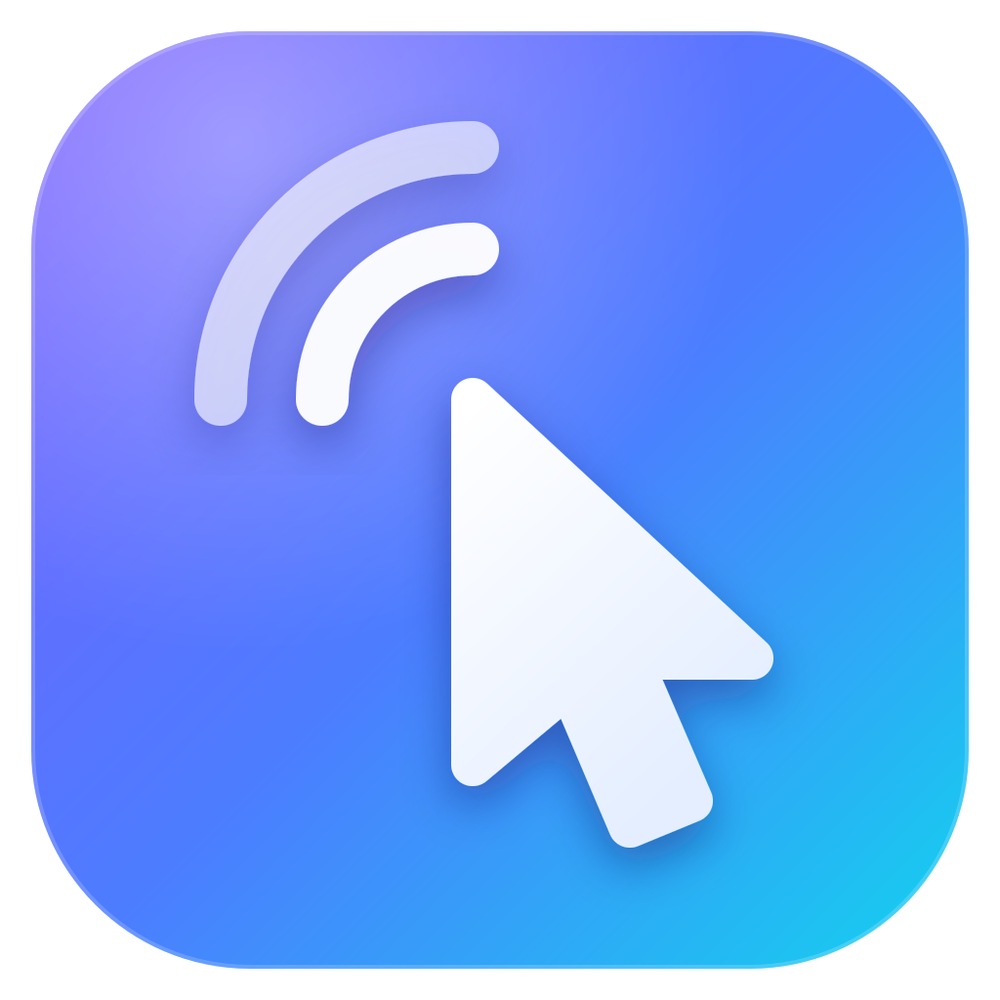

<p align="center"></p>

<h1 align="center">Airhand</h1>
<p align="center">High-performance remote desktop over QUIC · Rust + Tauri + React</p>
<p align="center"><b>English</b> · <a href="README.zh-CN.md">简体中文</a></p>

---

Airhand is a single program that is both the **host** (the computer being controlled) and the **controller** (the computer you control it from). It runs on **Windows**, **macOS** (13 or later) and **Linux** (X11 desktops). A small relay server, deployed with one Docker Compose command, handles signaling and forwards traffic. The controller can also be deployed with Docker Compose as a **web console** that you use from a browser.

> **Status:** under active development. The protocol still changes between versions, so the clients and the server must be built from the same version (a mismatch is detected and reported, see [Protocol versions](#protocol-versions)).

## Features

- **Host by default**: after launch there is only a tray icon, no window, and no WebView is started
- **Controller console**: control **several computers at once**, switch between them, or watch them all in a multi-screen overview
- **Web console**: start the controller with Docker Compose and open one port in a browser; nothing to install on the computer you control from (see [Web console](#web-console-docker))
- **Low latency, low bandwidth**: hardware **AV1 / HEVC / H.264** encoding, no frames when the screen is still, adaptive bitrate, the cursor moves locally with no lag
- **Audio**: the host's system sound is streamed to the controller, with optional A/V sync for watching video
- **Practical tools**: two-way clipboard sync, typing the clipboard as keystrokes, system shortcuts (Win, Alt+Tab, Ctrl+Shift+Esc…), multiple monitors, fullscreen with keyboard lock
- **Zero files**: no config file, nothing is left on disk (see [below](#zero-files))
- **Secure by default**: TLS 1.3 with certificate pinning, brute-force protection for control codes
- **English and Simplified Chinese**: follows the system language, switchable at any time

## Contents

- [Quick start](#quick-start)
- [Usage](#usage)
- [Server configuration](#server-configuration)
- [Web console (Docker)](#web-console-docker)
- [Building the client](#building-the-client)
- [How it works](#how-it-works)
- [Security](#security)
- [Known limitations](#known-limitations)
- [Development](#development)

## Quick start

1. **Deploy the server** on a machine both computers can reach (only **UDP 4433** needs to be open):

   ```bash
   docker compose up -d
   docker compose logs airhand | grep fingerprint   # note the certificate SHA-256 fingerprint
   ```

2. **Build the client** with the server address and fingerprint compiled in (requirements and the macOS / Linux steps in [Building the client](#building-the-client)):

   ```powershell
   cd client
   npm install
   $env:AIRHAND_SERVER    = "relay.example.com:4433"
   $env:AIRHAND_SERVER_FP = "<fingerprint from step 1>"
   npm run tauri build -- --no-bundle
   # → client/src-tauri/target/release/airhand.exe (single file, ~9 MB)
   ```

3. **Run it on both computers.** On the remote one, right-click the tray icon to see its 6-digit **control code**. On yours, choose **Switch to controller** in the tray menu and enter the code.

   If you'd rather not install the client on the computer you control from, use the [web console](#web-console-docker) instead: `cd web && AIRHAND_SERVER=relay.example.com:4433 AIRHAND_SERVER_FP=<fingerprint> docker compose up -d`, then open it in a browser.

## Usage

### Host (default)

Double-click to run. A tray icon appears in the bottom-right corner (on macOS in the menu bar at the top of the screen, on Linux in the top bar / panel status area). Grey means not connected to the server, coloured means connected. The right-click menu (a plain click on macOS) contains:

- Current mode and server status
- The **control code** and "Copy control code"
- Who is controlling this computer right now, and **Disconnect all controllers**
- **Change control code**: the old code stops working immediately and connected controllers are disconnected
- Switch to controller / Language / Quit

After a network drop the host reconnects automatically with exponential backoff and **gets its old control code back**, even after a server restart. A code is reserved for its host for 10 minutes after the host goes offline.

> On Linux the tray icon uses AppIndicator. It works out of the box on Ubuntu, KDE, Xfce and similar; stock GNOME needs the "AppIndicator and KStatusNotifierItem Support" extension. Without an AppIndicator library the program still runs as a host and prints the control code to the log (stderr).

> On macOS the host needs two system permissions: **Screen & System Audio Recording** (to capture the screen and sound) and **Accessibility** (to control the keyboard and mouse). macOS asks on the first start; while one is missing, the menu says so, and clicking that item opens the matching page in System Settings → Privacy & Security. A connected controller is told which permission is missing too (in the controller's own language), and the message goes away once it is granted. After granting Screen & System Audio Recording, reopen Airhand. Airhand normally lives in the menu bar only and shows up in the Dock while the console is open.

### Controller

Tray → **Switch to controller** opens the console. Closing the console window switches back to host mode.

- Enter a 6-digit control code to connect (pasting `123 456` works). Connect to as many computers as you like, switch between them in the left-hand list, or open the **Multi-screen overview**
- Toolbar: monitor switch, **Quality**, shortcuts, clipboard (two-way sync / type as keystrokes), sound (mute / A/V sync), actual size (1:1), fullscreen, disconnect
- In fullscreen the console tries to lock the keyboard, so system shortcuts such as the Win key and Alt+Tab go to the remote computer
- Network hiccups reconnect automatically. If the user at the host disconnects you, the console says so and doesn't reconnect

**Quality panel**: presets from Data saver (720p / 24 fps / 1.2 Mbps) through Balanced (1080p / 30 fps / 4 Mbps), Smooth (1080p / 60 fps / 8 Mbps) and HD (1440p / 60 fps / 16 Mbps) to Original (native resolution / 60 fps / 30 Mbps), or set the resolution cap, frame rate (15–120), bitrate cap (0.5–50 Mbps), codec and adaptive bitrate yourself. The console only offers codecs this computer can hardware-decode; if the host has no matching hardware encoder it falls back automatically, and the toolbar shows the encoder actually in use.

### Language

The console and tray menu are available in **English** and **Simplified Chinese**. By default the client follows the system display language: Chinese if it is Chinese, English otherwise. Switch any time from the tray menu (Language / 语言) or the 中文 / EN switch at the bottom-left of the console; like every other setting it isn't saved.

Notices and errors from the other computer or the server are sent as message types, not text, so they always appear in **your** language. Logs (client and server) are always in English.

## Server configuration

The server listens on **UDP 4433**. On first start it generates a self-signed certificate in the `data/` directory next to `docker-compose.yml`. **Keep that directory**: clients recognise the server by the certificate's fingerprint.

Environment variables (see `docker-compose.yml`):

| Variable | Default | Description |
|---|---|---|
| `AIRHAND_LISTEN` | `0.0.0.0:4433` | Listen address (UDP) |
| `AIRHAND_CERT` / `AIRHAND_KEY` | `/data/cert.pem` / `/data/key.pem` | Certificate paths; generated automatically if missing |
| `AIRHAND_CERT_NAMES` | `airhand,localhost` | SANs written into an auto-generated certificate |
| `AIRHAND_MAX_SESSIONS` | `4` | Max simultaneous controllers per host |
| `RUST_LOG` | `info` | Log level |

The image is based on distroless, runs as a non-root user, and is about 28 MB.

## Web console (Docker)

The controller can also run in a container: start it with Docker Compose and open one port in a browser to get the console, with nothing to install or build on the computer you control from. It's the same console as the desktop one (several sessions, multi-screen overview, quality, sound, clipboard…); the computers being controlled still run the Airhand client.

```bash
cd web
AIRHAND_SERVER=relay.example.com:4433 AIRHAND_SERVER_FP=<relay certificate fingerprint> docker compose up -d
# or: cp .env.example .env, edit it, then just docker compose up -d
```

Then open it in a browser:

- On the computer running the container: `http://localhost:8080`
- From other computers: `https://<this computer's address>:8080`

The same port speaks both HTTP and HTTPS. Browsers only offer WebCodecs video decoding on secure pages (HTTPS or localhost), so use https:// from other computers (opened over http://, the page links you to the https address). The certificate is a self-signed one generated on first start and kept in a data volume; the first time, the browser warns about it, and you continue to the site. Needs Chrome / Edge, Safari 16.4+ or Firefox 130+.

Environment variables (see `web/docker-compose.yml` and `web/.env.example`):

| Variable | Default | Description |
|---|---|---|
| `AIRHAND_SERVER` | (required) | Relay server address `host:port` |
| `AIRHAND_SERVER_FP` | empty | Relay certificate fingerprint. Empty means the certificate is **not verified**; for development only (the console shows "Not pinned") |
| `AIRHAND_NAME` | `Airhand Web` | The name shown in the host's tray under who is controlling it |
| `AIRHAND_WEB_PASSWORD` | empty | Access password: the browser shows a login prompt, any user name works. Empty means anyone who can reach the port can use the console (connecting to a computer still needs its control code) |
| `AIRHAND_WEB_PORT` | `8080` | Port published on the Docker host |
| `AIRHAND_WEB_CERT_NAMES` | `localhost` | Names / IPs written into the generated HTTPS certificate (comma-separated). List the address you actually use if you want the OS to trust the certificate |
| `AIRHAND_WEB_CERT` / `AIRHAND_WEB_KEY` | `/data/cert.pem` / `/data/key.pem` | HTTPS certificate paths; mount your own certificate here to use it |
| `RUST_LOG` | `info` | Log level |

- Each browser tab is a separate console with its own connection to the relay; closing or reloading the tab disconnects its sessions (the browser asks first while there are sessions). If the connection to the web service drops, the page reconnects and the sessions resume on their own
- Frames are acknowledged only once the browser has them, so the host's in-flight frame control covers the service-to-browser link too, and a slow link there doesn't make frames pile up. The latency in the toolbar is the service-host round trip plus the browser-service round trip, so run the service close to the browser (on the same LAN, for example)
- The clipboard is the browser's: text copied on the remote computer is written to this computer's clipboard (while the page is in front); text copied here is sent when you come back to the page, which needs the browser's permission to read the clipboard (Chrome / Edge ask the first time). Firefox doesn't let pages read the clipboard on their own, so there it only syncs from the remote side
- Outside fullscreen the browser keeps some shortcuts (Ctrl+W, Ctrl+T…) for itself; in fullscreen Chrome / Edge lock the keyboard, so the Win key, Alt+Tab and the like go to the remote computer
- Behind a reverse proxy (for your own domain and certificate): proxy to the container's `http://…:8080`, forward WebSockets (`/ws`) and keep the `Host` header (or set `X-Forwarded-Host`), otherwise the WebSocket is rejected as cross-site. A sub-path works too
- The image is based on distroless, runs as a non-root user, and is about 30 MB. It only needs outbound UDP (to the relay) and this one inbound TCP port

## Building the client

Requirements: Rust (stable), Node.js 20+, CMake (to build libopus).

- **Windows**: Windows 10/11 (WebView2 ships with the OS)
- **macOS**: macOS 13 or later and the Xcode Command Line Tools (`xcode-select --install`); CMake can come from `brew install cmake`
- **Linux**: Tauri's dependencies, the PulseAudio development files and the GStreamer plugins the console uses to decode video. On Debian / Ubuntu:

  ```bash
  sudo apt install build-essential cmake pkg-config libssl-dev libwebkit2gtk-4.1-dev \
    libayatana-appindicator3-dev librsvg2-dev libxdo-dev libpulse-dev \
    gstreamer1.0-plugins-base gstreamer1.0-plugins-good gstreamer1.0-plugins-bad gstreamer1.0-libav
  ```

The server address and certificate fingerprint are **compiled into the program**: set `AIRHAND_SERVER` and `AIRHAND_SERVER_FP` at build time (as in [Quick start](#quick-start)), or change the defaults in `client/src-tauri/src/config.rs`. Without `AIRHAND_SERVER` the client connects to `127.0.0.1:4433`. A malformed fingerprint (it must be 64 hex digits; `:` and spaces are allowed) fails the build.

> When `AIRHAND_SERVER_FP` is empty the **server certificate is not verified**, which leaves you open to man-in-the-middle attacks. Use that for development only; the console then shows "Not pinned" at the top left.

**Windows**: `npm run tauri build -- --no-bundle` produces `client/src-tauri/target/release/airhand.exe`. Drop `--no-bundle` to also get an NSIS installer.

- The C runtime is statically linked, so the VC++ redistributable isn't needed
- Media Foundation is delay-loaded, so Windows N editions (without the Media Feature Pack) still run and use software encoding

**Linux** (set the variables with `export AIRHAND_SERVER=...`):

```bash
cd client && npm install
npm run tauri build
# → client/src-tauri/target/release/airhand (single file, ~10 MB)
#   client/src-tauri/target/release/bundle/deb/Airhand_<version>_amd64.deb (pulls in the tray, audio and GStreamer dependencies)
```

**macOS** (set the variables with `export` as well):

```bash
cd client && npm install
npm run tauri build
# → client/src-tauri/target/release/bundle/macos/Airhand.app (~8 MB)
#   client/src-tauri/target/release/bundle/dmg/Airhand_<version>_<arch>.dmg
```

- For just the .app use `npm run tauri build -- --bundles app`; it is built for the machine's own architecture (arm64 on Apple silicon)
- The app is only ad-hoc signed, not notarized: the first time you open a copy on another Mac, right-click it in Finder → Open (or run `xattr -dr com.apple.quarantine Airhand.app`)
- macOS remembers granted permissions by code signature, and an ad-hoc signature changes with every build: after rebuilding, remove Airhand in System Settings → Privacy & Security and grant the permissions again. For long-term use, put your own Developer ID in `signingIdentity` in `client/src-tauri/tauri.macos.conf.json`

## How it works

### Architecture

```
 Host (Windows; others: see table)       airhand-server (Docker)                  Controller (Tauri / web)
┌───────────────────────────┐            ┌───────────────────────────┐            ┌───────────────────────────┐
│ DXGI capture (GPU)        │            │ Control-code registry     │            │ WebCodecs HW decode       │
│ SIMD scale + NV12 convert │  QUIC/TLS  │ Session pairing           │  QUIC/TLS  │ Low-latency Canvas        │
│ HW encode AV1/HEVC/H.264  │◀══════════▶│ Zero-copy byte relay      │◀══════════▶│ Input capture + cursor    │
│ SendInput injection       │   UDP 4433 │ Brute-force rate limiting │   UDP 4433 │ Multi-session / overview  │
│ WASAPI loopback + Opus    │            │                           │            │ Jitter-buffered audio     │
└───────────────────────────┘            └───────────────────────────┘            └───────────────────────────┘
```

The first bidirectional stream on every QUIC connection is the **control stream** (signaling). For each remote-control session both sides open another bidirectional stream; the server pairs them by session ID and from then on **only forwards bytes, it never parses the video**. Every message is a `u32` length prefix followed by a postcard-encoded payload.

The web console splits the controller on the right in two: the QUIC connection and session handling run in `airhand-web` (the container), while decoding, rendering and input capture stay in the browser, with one WebSocket in between. Packets are forwarded to the browser unchanged (with a 4-byte session number in front), and the browser acknowledges the frames.

| Directory | Contents |
|---|---|
| `crates/airhand-proto` | Protocol: signaling, session messages, framing |
| `crates/airhand-link` | The client side of the relay link: QUIC, certificate pinning, reconnects, UI-independent controller sessions, `Problem`. Shared by the desktop client and the web console |
| `server/` | Relay server (quinn + rustls) and its `Dockerfile` |
| `web/` | Web console service (axum: static files + WebSocket, HTTP and HTTPS on one port), its `Dockerfile` and `docker-compose.yml`. A separate Cargo workspace, like `client/src-tauri/` |
| `client/src-tauri/` | Desktop client, Rust side: host `host/`, tray, console window and commands |
| `client/src/` | Console UI (React 19 + TypeScript, no UI library), shared by the desktop and web consoles, which differ only in `client/src/lib/backend/`; strings in `client/src/locales/` |
| `assets/icon.svg` | Application icon source |

How each host stage is implemented on the three platforms:

| Stage | Windows | macOS | Linux (X11) |
|---|---|---|---|
| Screen capture | DXGI Desktop Duplication | ScreenCaptureKit | MIT-SHM shared memory + DAMAGE change notifications; RandR for multiple monitors |
| Cursor shape | DXGI | NSCursor | XFIXES |
| Video encoding | Media Foundation hardware encoders, OpenH264 fallback | VideoToolbox hardware encoders (H.264 / HEVC), OpenH264 fallback | OpenH264 |
| Input injection | SendInput (scan codes) | CGEvent (virtual key codes) | XTEST (evdev physical key codes) |
| Audio capture | WASAPI loopback | ScreenCaptureKit (system mix) | PulseAudio / PipeWire output monitor |
| Clipboard | Change detection via the clipboard sequence number | NSPasteboard change count | XFIXES selection-owner change notifications |
| Console UI | WebView2 | WKWebView | WebKitGTK (WebCodecs decoding via GStreamer) |

### Video

| Stage | How it works |
|---|---|
| Capture | Frames are only produced when the screen changes (DXGI on Windows, ScreenCaptureKit on macOS, DAMAGE on X11), so an idle desktop uses almost no bandwidth |
| Preprocessing | `fast_image_resize` (SIMD) for scaling, `yuvutils-rs` (AVX2) for BGRA→NV12/I420; all buffers are reused |
| Encoding | **Hardware first**: Media Foundation hardware encoders (NVENC / Quick Sync / AMF) for **AV1 / HEVC / H.264**, low-latency mode, no B-frames, very long GOP; on macOS VideoToolbox (H.264 / HEVC, low-latency rate control for H.264). Without one it falls back to **OpenH264 in screen-content mode** |
| Rate control | The controller ACKs every frame. The host caps the number of **in-flight frames** (≈ RTT × fps + 2); on a slow network it waits and **skips to the newest frame** instead of building up lag. Adaptive bitrate steps down under congestion and recovers gradually |
| Transport | QUIC with **BBR** congestion control (steadier than Cubic on lossy links such as Wi-Fi or cross-border routes). Control messages, audio and video are queued separately, so pings and mouse events never wait behind a large frame |
| Decoding | The controller decodes on the GPU with **WebCodecs** (`optimizeForLatency`) and paints straight into a `desynchronized` Canvas |
| Cursor | The remote cursor's **shape** is mirrored to the local cursor and movement is handled locally, so there is **no perceptible cursor lag** |
| Background sessions | Sessions that aren't on screen drop to 5 fps |

Measured locally (RTX GPU, 4K display output at 1080p): hardware AV1 encodes a frame in about 7 ms, H.264 in about 9 ms; OpenH264 software encoding takes about 40 ms.

### Audio

The host's system sound (not the microphone) is streamed to the controller:

| Stage | How it works |
|---|---|
| Capture | Loopback capture of the default output device, converted to 48 kHz stereo; follows the default device when it changes (e.g. you plug in headphones) |
| Encoding | Opus at 96 kbps, 20 ms per packet; **no packets during silence** |
| Transport | Same stream as the video, queued after control messages and before video; when the queue is full packets are dropped instead of building up lag |
| Playback | WebCodecs decoding → AudioWorklet adaptive jitter buffer: about 40 ms on a stable network, growing under jitter and shrinking back once stable. A ±1–2% speed adjustment cancels the clock drift between the two sound cards, and a large backlog is skipped |

Only the session you are looking at plays audio (none do in the multi-screen overview); the other hosts are told to stop capturing.

When the host can't capture sound (no audio output device, or no PulseAudio / PipeWire running on Linux, for example), the controller shows a message, the speaker in the toolbar gets a yellow dot and the sound menu gives the reason. The host retries every 2 seconds, and the message goes away once it recovers.

### A/V sync (optional, off by default)

Audio goes through a jitter buffer while video is shown as soon as it arrives, so by default audio lags video slightly: about **70 ms** in our measurements (same machine, local relay, 4K output at 1080p; 49–78 ms per run). That's barely noticeable while working, but may be when watching video.

With **A/V sync** turned on (speaker menu in the toolbar):

- Video frames and audio packets both carry the host's capture time on the same clock (DXGI present time and WASAPI QPC timestamps). The controller measures the capture → display/playback latency of each stream separately; **the clock offset between the two computers cancels out**, so no time sync is needed
- Normally each frame is delayed until it lines up with the audio. If the video is the slower one (tight bandwidth), the audio is buffered longer instead (up to 300 ms); a single slow frame doesn't trigger this
- Measured residual offset: **−3 to −4 ms** on average (negative = audio slightly early), worst case −31 ms, inside the range generally considered imperceptible (audio ahead by up to about 45 ms)
- Trade-off: video appears about 70 ms later, so typing and dragging feel slower; it suits watching video, not working. The cursor is drawn locally and is unaffected. The toolbar shows "Sync +N ms"

The delay from painting to the Canvas to the pixels lighting up is estimated at 8 ms (not measured with a camera).

### Zero files

- No config file; the server address is compiled in. Logs go to stderr only
- Host mode **doesn't create a WebView**, so it creates no files at all
- The single-instance lock is a kernel object, not a lock file: a named mutex on Windows, an abstract-namespace Unix socket on Linux, a Mach port name registered with the bootstrap server on macOS
- The console's WebView needs a data directory: it lives in a random subdirectory of the temp directory, runs in private mode (no cookies or cache saved), and is deleted when the window closes or the program exits. If the process is killed, leftovers are removed on the next start. On macOS WKWebView needs no data directory and writes nothing to disk in private mode
- On Linux, the few things that can only be handed over as files (the tray icon for AppIndicator, WebKitGTK's GStreamer plugin cache) live in a random per-process directory under `XDG_RUNTIME_DIR` (a RAM disk) that is removed on exit, including on SIGTERM / SIGINT. The Mesa / NVIDIA on-disk shader caches are turned off
- Controller settings live in memory only
- All of the above is about the desktop client. The web console is a service you deploy: it keeps its self-signed HTTPS certificate in a data volume, and the browser also keeps settings in memory only (plus a session cookie when a password is set)

## Security

- TLS 1.3 throughout (QUIC); the client verifies the server by **certificate fingerprint pinning**
- Brute-force protection: at most 20 failed attempts per IP (IPv6 grouped by /64) per 10 minutes, and each failure adds a 400 ms delay
- Getting a control code back after a reconnect requires a random secret, so nobody else can claim it
- The host's tray always shows who is controlling the computer; disconnect them or change the code with one click
- The relay server can see the content of session streams (TLS ends at the server), so run it on a machine you trust
- Web console: the WebSocket only accepts pages from the same site (so other websites can't connect through your browser); an access password can be set (HTTP Basic login, then an HttpOnly, SameSite=Strict cookie; wrong passwords are answered with a delay); use HTTPS from other computers. The web console sees the picture too, so run it on a machine you trust. Everyone using it reaches the relay from that machine's IP, so they share the brute-force allowance

## Known limitations

- The host supports Windows and Linux **X11** desktops. Under Wayland only X11 (XWayland) applications can be seen and controlled; native Wayland windows are black and the controller suggests logging in with an X11 (Xorg) session. Full Wayland support needs xdg-desktop-portal screen sharing (the local user has to confirm each time) and isn't implemented
- The Linux host only has OpenH264 software encoding (no VA-API / NVENC yet); when AV1 / HEVC is selected it uses H.264
- Decoding on a Linux controller relies on WebKitGTK + GStreamer: H.264 needs `gstreamer1.0-plugins-bad` (parsing) and `gstreamer1.0-libav` or openh264 (decoding); AV1 / HEVC depend on the installed GStreamer decoders. If a format turns out not to produce a picture, the controller switches to H.264
- Without elevated privileges on Windows, UAC prompts and the lock screen can't be captured or controlled (they are on the secure desktop; that would need a SYSTEM service), and `Ctrl+Alt+Del` can't be injected. On Linux the lock screen is similar (the screensaver grabs the keyboard and mouse)
- The macOS host needs the Screen & System Audio Recording and Accessibility permissions, which only the local user can grant in System Settings; since macOS 15 the system also asks again from time to time whether to keep allowing screen recording. The login window and the lock screen can't be captured or controlled
- A Mac host doesn't offer AV1 (current Apple chips can only decode it in hardware), so AV1 shows as unavailable in the console
- A macOS controller (WKWebView) can't lock the keyboard: in fullscreen, Command+Tab, Command+Space and the like are still handled locally, so use "Send shortcut" in the toolbar. WKWebView on older macOS versions may lack Opus decoding, in which case the console says remote audio can't be played
- The clipboard syncs text only, not files
- Audio flows from host to controller only; the controller's microphone isn't forwarded. Audio is captured after the volume control, so a muted host sends silence
- Web console: reloading or closing the tab disconnects its sessions; in Firefox, text copied locally isn't synced to the remote side automatically; outside fullscreen some shortcuts (Ctrl+W…) can't reach the remote computer

## Development

### Tests

```bash
# repository root: protocol + link library + server
cargo test

# web/: web console (WebSocket protocol, password, HTTPS certificate)
cargo test

# client/: UI (jitter buffer and A/V sync simulations, H.264 conversion, UI strings)
npm test

# client/src-tauri/: client Rust (encoders incl. hardware probing, Opus packing, format conversion…)
cargo test --lib
# audio loopback capture (needs an audio output device; plays a 1.5 s test tone at -60 dBFS, barely audible)
cargo test --lib loopback_captures_tone -- --ignored --nocapture
```

On macOS the screen / audio capture tests (`sck_capture`, `loopback_captures_tone`, video and audio in the end-to-end test) and the input injection test (`mac_move_to_center`) need the Screen & System Audio Recording and Accessibility permissions for the terminal that runs them (System Settings → Privacy & Security). Without them `sck_capture`, `loopback_captures_tone` and `mac_move_to_center` skip themselves; the end-to-end test checks that the host reports the missing permission (rather than a capture failure) and then skips the video and audio checks (clipboard, ping, disconnect and the rest are still checked).

End to end (a real server, a real host with screen capture and encoding, and a protocol-level controller):

```bash
# repository root: start a server without certificate pinning
cargo build -p airhand-server
AIRHAND_CERT=target/e2e/cert.pem AIRHAND_KEY=target/e2e/key.pem ./target/debug/airhand-server &

# client/src-tauri/
cargo test --lib e2e_roundtrip -- --ignored --nocapture   # video / codec switching / clipboard / audio / ping / disconnect
cargo test --lib e2e_reconnect -- --ignored --nocapture   # getting the code back after a server restart, changing the code
```

### Debugging tools

```bash
# client/: debug build that starts straight in controller mode; AIRHAND_LOG sets the log level
AIRHAND_DEV_CONTROLLER=1 AIRHAND_LOG=debug npm run tauri dev
# client/: A/V sync measurement (the host plays a white flash + short beep; usage at the top of the script)
node scripts/measure-avsync.mjs <control-code>

# client/src-tauri/: headless host, for testing the controller on the same machine
# (mute the controller, otherwise the played-back audio is captured again and echoes)
cargo run --release --example headless_host
# client/src-tauri/: encoder benchmark (captures the real screen and compares the encoders)
cargo run --release --example encode_bench
```

Use release builds when judging smoothness or A/V sync: debug builds scale very slowly (4K → 1080p takes about 0.5 s per frame).

### Web console

```bash
# build the UI, then start the service in web/ (connects to a server on 127.0.0.1:4433, serves ../client/dist); open http://localhost:8080
(cd client && npm run build)
cd web && cargo run
# while working on the UI: npm run dev in client/ and open http://localhost:1420 (/ws is proxied to airhand-web on port 8080)
```

The WebSocket protocol between the browser and the service is described at the top of `web/src/console.rs`.

### Linux / WSL

`bash client/scripts/linux-test.sh` runs all of the tests above (unit, X11 capture and input injection, audio loopback, end to end, frontend). The X11 tests open fullscreen windows and inject input, so the script starts its own Xvfb screen and leaves your desktop alone; audio tests are skipped without PulseAudio / PipeWire. It needs `sudo apt install xvfb x11-apps`.

On Windows you can use WSL2 (tested on Ubuntu 24.04; WSLg ships with PulseAudio):

```bash
# Copy the repository to WSL's own disk first (building under /mnt/c or /mnt/d is much slower)
rsync -a --exclude target --exclude node_modules /mnt/d/work/Projects/airhand/ ~/airhand/
cd ~/airhand && bash client/scripts/linux-test.sh
```

- The console works in WSLg: `AIRHAND_DEV_CONTROLLER=1 npm run tauri dev` opens it on the Windows desktop
- To run a host: `Xvfb :99 &`, then `DISPLAY=:99 cargo run --example headless_host` (WSLg's own desktop is Wayland)
- WSL2 uses NAT networking by default: Windows programs reach a server inside WSL through WSL's IP (`ip addr show eth0`), e.g. `AIRHAND_SERVER=172.30.x.x:4433`

### Conventions

#### Protocol versions

Client and server compare `PROTOCOL_VERSION` (`crates/airhand-proto/src/lib.rs`) when they connect. On a mismatch the server replies `Incompatible` and the client tells the user whether to update Airhand or the server, then retries once a minute. Bump the version for any incompatible protocol change. The handshake itself (`ClientMsg::Hello`, `ServerMsg::Welcome` / `Incompatible`, the ALPN) must **never** change, otherwise different versions can't even tell each other that they differ. The `version_handshake_wire_is_stable` test guards this.

#### Messages are types, not text

Anything the user may see that crosses the network or comes from the Rust side is an enum (`ConnectError`, `Notice`, `ByeReason`, `Problem`…). The UI turns it into text in the user's language:

- Console strings live in `client/src/locales/zh.ts` (the full list of keys) and `en.ts`
- Tray strings use `tr!` in `client/src-tauri/src/tray.rs`
- `npm test` fails if a Rust `Problem` / `NoticeView` variant has no string in either language
- Logs and internal errors are English

#### Icon

The source is `assets/icon.svg`. After editing it, run `npx tauri icon ../assets/icon.svg -o src-tauri/icons` in `client/`, then copy `src-tauri/icons/32x32.png` to `src-tauri/icons/tray.png`.
