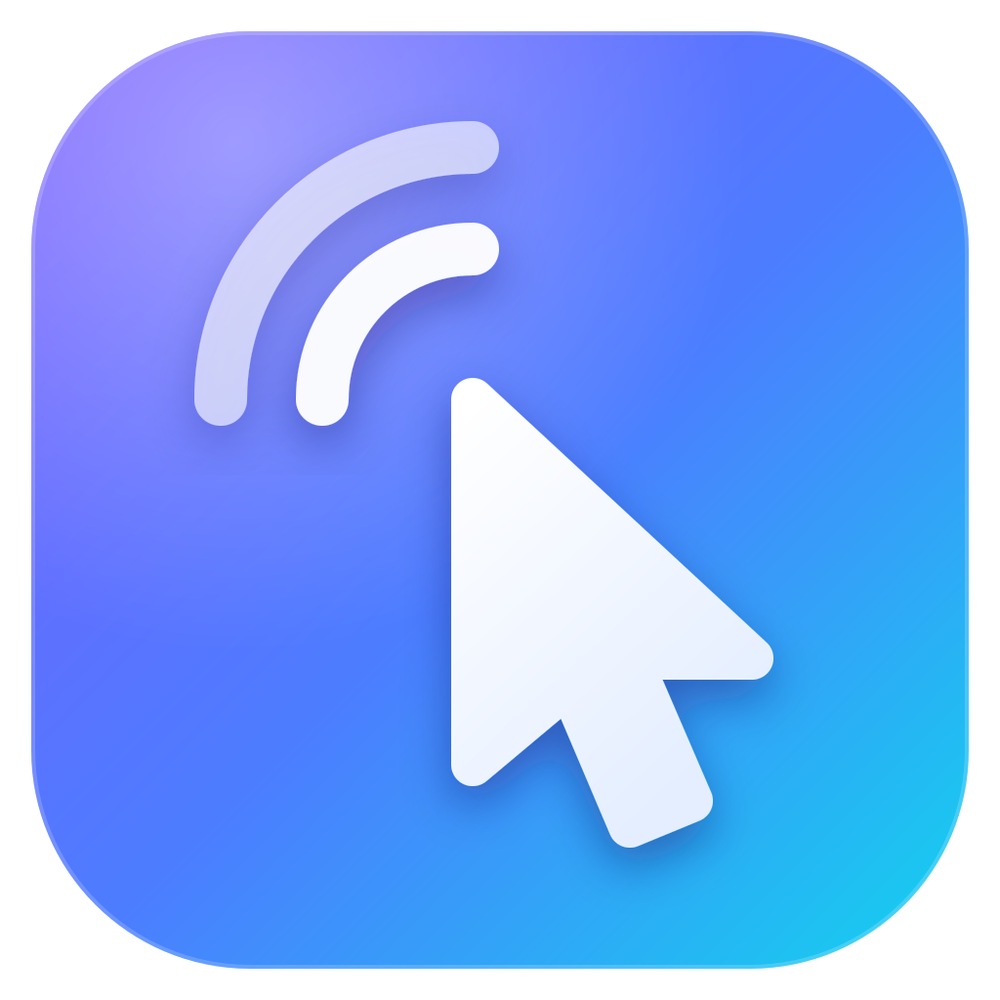

<p align="center"></p>

<h1 align="center">Airhand</h1>
<p align="center">基于 QUIC 的高性能远程桌面 · Rust + Tauri + React</p>
<p align="center"><a href="README.md">English</a> · <b>简体中文</b></p>

---

Airhand 是一个程序，同时包含**被控端**（被远程控制的电脑）和**控制端**（你用来操作的电脑），支持 **Windows**、**macOS**（13 及以上）和 **Linux**（X11 桌面）。另有一个很小的中转服务器，用 Docker Compose 一条命令部署，负责信令和转发。控制端也可以用 Docker Compose 部署成**网页控制台**，在浏览器里使用。

> **状态：**开发中。协议在版本之间还会变化，客户端和服务器需要用同一个版本构建（版本不一致时会检测出来并提示，见[协议版本](#协议版本)）。

## 功能

- **默认是被控端**：启动后只有一个托盘图标，没有窗口，也不启动 WebView
- **控制台**：**同时控制多台电脑**，随时切换，或者在多屏总览里同时看所有画面
- **网页控制台**：控制端用 Docker Compose 启动，浏览器打开一个端口就能用，操作的电脑上什么都不用装（见[网页控制台](#网页控制台docker)）
- **低延迟、省带宽**：硬件 **AV1 / HEVC / H.264** 编码，画面不变就不发帧，自适应码率，鼠标指针在本地移动、没有延迟
- **声音**：被控端的系统声音同步到控制端，看视频时可以打开音画同步
- **实用工具**：剪贴板双向同步、以键盘输入方式发送剪贴板、系统快捷键（Win、Alt+Tab、Ctrl+Shift+Esc 等）、多显示器、全屏时锁定键盘
- **零文件**：没有配置文件，不在磁盘上留下任何东西（见[下文](#零文件)）
- **默认安全**：TLS 1.3 + 证书指纹固定，控制码防暴力猜测
- **中英双语**：跟随系统语言，可以随时切换

## 目录

- [快速开始](#快速开始)
- [使用](#使用)
- [服务端配置](#服务端配置)
- [网页控制台（Docker）](#网页控制台docker)
- [构建客户端](#构建客户端)
- [工作原理](#工作原理)
- [安全](#安全)
- [已知限制](#已知限制)
- [开发](#开发)

## 快速开始

1. **部署服务端**：放在两台电脑都能访问到的机器上（只需开放 **UDP 4433**）：

   ```bash
   docker compose up -d
   docker compose logs airhand | grep fingerprint   # 记下证书 SHA-256 指纹
   ```

2. **构建客户端**，把服务器地址和指纹编译进程序（依赖以及 macOS、Linux 的步骤见[构建客户端](#构建客户端)）：

   ```powershell
   cd client
   npm install
   $env:AIRHAND_SERVER    = "relay.example.com:4433"
   $env:AIRHAND_SERVER_FP = "<第 1 步记下的指纹>"
   npm run tauri build -- --no-bundle
   # → client/src-tauri/target/release/airhand.exe（单个文件，约 9 MB）
   ```

3. **两台电脑上都运行它**。在被控的电脑上右键托盘图标，看到 6 位**控制码**；在你自己的电脑上从托盘菜单选择**切换为控制端**，输入控制码。

   不想在操作的电脑上装客户端的话，也可以用[网页控制台](#网页控制台docker)：`cd web && AIRHAND_SERVER=relay.example.com:4433 AIRHAND_SERVER_FP=<指纹> docker compose up -d`，然后用浏览器打开。

## 使用

### 被控端（默认）

双击运行，右下角（macOS 是屏幕顶部的菜单栏，Linux 是顶栏 / 任务栏的状态区）出现托盘图标：灰色表示没连上服务器，彩色表示已连接。右键（macOS 上单击）菜单里有：

- 当前模式、服务器状态
- **控制码**和"复制控制码"
- 正在控制本机的控制端，以及**断开所有控制端**
- **更换控制码**：旧码立即失效，已连接的控制端会被断开
- 切换为控制端 / 语言 / 退出

掉线后会按指数退避自动重连，并且**取回原来的控制码**（服务器重启后也能取回）。被控端离线后 10 分钟内，它的控制码不会分配给别人。

> Linux 的托盘图标走 AppIndicator：Ubuntu、KDE、Xfce 等开箱即用，原版 GNOME 需要装 "AppIndicator and KStatusNotifierItem Support" 扩展。没有 AppIndicator 库时程序照常作为被控端运行，控制码打印在日志（stderr）里。

> macOS 上被控端需要两项系统权限：**屏幕与系统录音**（采集画面和声音）和**辅助功能**（操作键盘鼠标）。第一次启动时系统会弹窗询问；没有授权时菜单里会有提示，点一下就打开"系统设置 → 隐私与安全性"里对应的页面；连上来的控制端也会看到对方缺少哪一项权限（按控制端自己的语言显示），对方授权后提示自动消失。授予"屏幕与系统录音"后需要重新打开 Airhand。Airhand 平时只在菜单栏里，打开控制台时才出现在程序坞中。

### 控制端

托盘 →**切换为控制端**，打开控制台。关闭控制台窗口会回到被控端模式。

- 输入 6 位控制码连接（可以直接粘贴 `123 456`）。可以连任意多台，在左侧列表切换，或者打开**多屏总览**
- 工具栏：显示器切换、**画质**、快捷键、剪贴板（双向同步 / 以键盘输入方式发送）、声音（静音 / 音画同步）、1:1 原始大小、全屏、断开
- 全屏时会尝试锁定键盘，Win 键、Alt+Tab 这类系统快捷键也发给远端
- 网络抖动导致的断开会自动重连；被控端的用户断开了你时，控制台会说明原因，不再重连
- 对方电脑离线了（关机、睡眠、断网）：控制台显示“等待对方重新上线”，对方一上线（取回原来的控制码）就自动连上。等待期间不会反复尝试，也不会被服务器当成猜码而限速

**画质面板**：预设从省流（720p / 24 fps / 1.2 Mbps）、均衡（1080p / 30 fps / 4 Mbps）、流畅（1080p / 60 fps / 8 Mbps）、高清（1440p / 60 fps / 16 Mbps）到原画（原始分辨率 / 60 fps / 30 Mbps），也可以自己调分辨率上限、帧率（15–120）、码率上限（0.5–50 Mbps）、编码格式和自适应码率。控制台只提供本机能硬件解码的格式；被控端没有对应的硬件编码器时会自动回退，工具栏上显示实际用的编码器。

### 界面语言

控制台和托盘菜单支持**简体中文**和**英文**。默认跟随系统显示语言：系统是中文就用中文，否则用英文。可以在托盘菜单"语言 / Language"或控制台左下角的"中文 / EN"随时切换；和其它设置一样不保存。

对方电脑和服务器发来的提示、错误都是消息类型而不是文字，所以总是按**你自己**的语言显示。日志（客户端和服务端）统一是英文。

## 服务端配置

服务器监听 **UDP 4433**。首次启动时会在 `docker-compose.yml` 同目录的 `data/` 下生成自签名证书，**请保留这个目录**：客户端靠证书指纹认出服务器。

环境变量（见 `docker-compose.yml`）：

| 变量 | 默认值 | 说明 |
|---|---|---|
| `AIRHAND_LISTEN` | `0.0.0.0:4433` | 监听地址（UDP） |
| `AIRHAND_CERT` / `AIRHAND_KEY` | `/data/cert.pem` / `/data/key.pem` | 证书路径，不存在时自动生成 |
| `AIRHAND_CERT_NAMES` | `airhand,localhost` | 自动生成证书时写入的 SAN |
| `AIRHAND_MAX_SESSIONS` | `4` | 每台被控端同时允许的控制端数量 |
| `RUST_LOG` | `info` | 日志级别 |

镜像基于 distroless、以非 root 用户运行，约 28 MB。

## 网页控制台（Docker）

控制端也可以跑在容器里：用 Docker Compose 启动，浏览器打开一个端口就是控制台，操作的电脑上不用安装或构建任何东西。界面和桌面版的控制台完全一样（多会话、多屏总览、画质、声音、剪贴板……）；被控的电脑仍然运行 Airhand 客户端。

```bash
cd web
AIRHAND_SERVER=relay.example.com:4433 AIRHAND_SERVER_FP=<服务器证书指纹> docker compose up -d
# 也可以 cp .env.example .env，改好后直接 docker compose up -d
```

然后用浏览器打开：

- 运行容器的这台电脑：`http://localhost:8080`
- 其它电脑：`https://<这台电脑的地址>:8080`

同一个端口同时支持 HTTP 和 HTTPS。浏览器只在安全的页面（HTTPS 或 localhost）上提供 WebCodecs 视频解码，所以从其它电脑访问要用 https://（用 http:// 打开时页面会给出 https 的链接）。证书是第一次启动时生成的自签名证书，保存在数据卷里，浏览器第一次会提示不安全，确认继续即可。需要 Chrome / Edge、Safari 16.4+ 或 Firefox 130+。

环境变量（见 `web/docker-compose.yml` 和 `web/.env.example`）：

| 变量 | 默认值 | 说明 |
|---|---|---|
| `AIRHAND_SERVER` | （必填） | 中转服务器地址 `host:port` |
| `AIRHAND_SERVER_FP` | 空 | 中转服务器的证书指纹。留空则**不校验证书**，只适合开发环境（控制台显示"未固定证书"） |
| `AIRHAND_NAME` | `Airhand Web` | 被控端托盘里"谁在控制"显示的名称 |
| `AIRHAND_WEB_PASSWORD` | 空 | 访问密码：浏览器弹出登录框，用户名随意。留空则任何能访问这个端口的人都能使用控制台（连接每台电脑仍然需要它的控制码） |
| `AIRHAND_WEB_PORT` | `8080` | 映射到宿主机的端口 |
| `AIRHAND_WEB_CERT_NAMES` | `localhost` | 自动生成 HTTPS 证书时写入的域名 / IP（逗号分隔）。想把证书导入系统信任时，填上实际访问用的地址 |
| `AIRHAND_WEB_CERT` / `AIRHAND_WEB_KEY` | `/data/cert.pem` / `/data/key.pem` | HTTPS 证书路径，用自己的证书时挂载进来 |
| `RUST_LOG` | `info` | 日志级别 |

- 每个浏览器标签页是一个独立的控制台，有自己到中转服务器的连接；关闭或刷新标签页会断开它的会话（有会话时浏览器会先确认）。和网页服务的连接断了会自动重连，会话随后自动恢复
- 画面要等浏览器收到后才确认，被控端的在途帧控制因此把"服务 → 浏览器"这段网络也算进去，这段网络慢时画面不会越积越多。工具栏显示的延迟 = 服务到被控端的往返 + 浏览器到服务的往返，所以服务最好部署在离浏览器近的地方（例如同一个局域网）
- 剪贴板用的是浏览器的剪贴板：对方复制的文本写进本机剪贴板（页面在前台时）；本机复制的文本在回到这个页面时发给对方，需要浏览器允许读取剪贴板（Chrome / Edge 第一次会询问）。Firefox 不允许网页自动读取剪贴板，只能从对方同步过来
- 不全屏时，Ctrl+W、Ctrl+T 等快捷键会被浏览器拦截；全屏时 Chrome / Edge 会锁定键盘，Win、Alt+Tab 等也发给远端
- 放在反向代理后面（例如用自己的域名和证书）：代理到容器的 `http://…:8080`，需要转发 WebSocket（`/ws`）并保留 `Host` 头（或设置 `X-Forwarded-Host`），否则会被当成跨站请求拒绝。可以放在子路径下
- 镜像基于 distroless、以非 root 用户运行，约 30 MB。只需要出站的 UDP（到中转服务器）和入站的这一个 TCP 端口

## 构建客户端

需要：Rust（stable）、Node.js 20+、CMake（编译 libopus）。

- **Windows**：Windows 10/11（系统自带 WebView2）
- **macOS**：macOS 13 及以上，Xcode 命令行工具（`xcode-select --install`）；CMake 可以用 `brew install cmake` 安装
- **Linux**：Tauri 的依赖、PulseAudio 开发库，以及控制台解码视频用的 GStreamer 插件。Debian / Ubuntu：

  ```bash
  sudo apt install build-essential cmake pkg-config libssl-dev libwebkit2gtk-4.1-dev \
    libayatana-appindicator3-dev librsvg2-dev libxdo-dev libpulse-dev \
    gstreamer1.0-plugins-base gstreamer1.0-plugins-good gstreamer1.0-plugins-bad gstreamer1.0-libav
  ```

服务器地址和证书指纹**编译进程序**：构建时设置 `AIRHAND_SERVER` 和 `AIRHAND_SERVER_FP`（同[快速开始](#快速开始)），或者修改 `client/src-tauri/src/config.rs` 里的默认值。不设置 `AIRHAND_SERVER` 时连接 `127.0.0.1:4433`。指纹的格式不对（不是 64 位十六进制，允许用 `:` 或空格分隔）时构建会直接报错。

> `AIRHAND_SERVER_FP` 留空时**不校验服务器证书**，无法防止中间人攻击，只适合开发环境；这时控制台左上角会显示"未固定证书"。

**Windows**：`npm run tauri build -- --no-bundle` 生成 `client/src-tauri/target/release/airhand.exe`；去掉 `--no-bundle` 会额外生成 NSIS 安装包。

- C 运行时是静态链接的，不需要装 VC++ 运行库
- Media Foundation 是延迟加载的，Windows N 版（没装媒体功能包）也能运行，会改用软件编码

**Linux**（环境变量用 `export AIRHAND_SERVER=...` 设置）：

```bash
cd client && npm install
npm run tauri build
# → client/src-tauri/target/release/airhand（单个文件，约 10 MB）
#   client/src-tauri/target/release/bundle/deb/Airhand_<版本>_amd64.deb（会自动装上托盘、声音、GStreamer 依赖）
```

**macOS**（环境变量同样用 `export` 设置）：

```bash
cd client && npm install
npm run tauri build
# → client/src-tauri/target/release/bundle/macos/Airhand.app（约 8 MB）
#   client/src-tauri/target/release/bundle/dmg/Airhand_<版本>_<架构>.dmg
```

- 只要 .app 时用 `npm run tauri build -- --bundles app`；构建的是本机的架构（Apple 芯片是 arm64）
- 程序只做了临时签名（ad-hoc），没有经过 Apple 公证：拷到别的 Mac 上第一次打开时，在访达里右键 → 打开（或者 `xattr -dr com.apple.quarantine Airhand.app`）
- 系统按签名记住授予的权限，而临时签名每次构建都会变：重新构建后要在"系统设置 → 隐私与安全性"里把 Airhand 删掉再重新授权。长期使用的话，在 `client/src-tauri/tauri.macos.conf.json` 里把 `signingIdentity` 换成自己的开发者证书

## 工作原理

### 架构

```
 被控端 (Windows，其它见下表)         airhand-server (Docker)                 控制端 (Tauri / 网页)
┌──────────────────────┐            ┌──────────────────────┐            ┌──────────────────────┐
│ DXGI 桌面复制 (GPU)   │            │ 控制码注册 / 找回     │            │ WebCodecs 硬件解码    │
│ SIMD 缩放 + NV12 转换 │  QUIC/TLS  │ 会话配对              │  QUIC/TLS  │ Canvas 低延迟渲染     │
│ 硬件编码 AV1/HEVC/264 │◀══════════▶│ 字节级零拷贝透传      │◀══════════▶│ 输入采集 + 光标同步   │
│ SendInput 注入        │   UDP 4433 │ 防暴力猜码限速        │   UDP 4433 │ 多会话 / 多屏总览     │
│ WASAPI 环回 + Opus    │            │                       │            │ 声音抖动缓冲播放      │
└──────────────────────┘            └──────────────────────┘            └──────────────────────┘
```

每条 QUIC 连接上的第一条双向流是**控制流**（信令）。每建立一个远控会话，双方各再开一条双向流，服务器按会话 ID 把两条流配对，之后**只转发字节、不解析画面**。每条消息是 `u32` 长度前缀加 postcard 编码的内容。控制端重连时带上连上时得到的重连凭证；被控端不在线时服务器记下它，被控端重新上线时发 `HostOnline` 通知（见 `crates/airhand-proto/src/signal.rs` 的“重连凭证”）。

网页控制台把右边的控制端拆成两半：QUIC 连接和会话管理在 `airhand-web`（容器）里，解码、渲染、输入采集仍在浏览器里，两者之间是一条 WebSocket。画面原样转发给浏览器（每个数据包前面加 4 字节的会话编号），浏览器收到后回确认。

| 目录 | 内容 |
|---|---|
| `crates/airhand-proto` | 协议：信令、会话消息、帧格式 |
| `crates/airhand-link` | 客户端到中转服务器的链路：QUIC 连接、证书固定、断线重连，与界面无关的控制端会话，`Problem`。桌面客户端和网页控制台共用 |
| `server/` | 中转服务器（quinn + rustls）及其 `Dockerfile` |
| `web/` | 网页控制台服务（axum：静态网页 + WebSocket，HTTP / HTTPS 同一端口）及其 `Dockerfile`、`docker-compose.yml`。和 `client/src-tauri/` 一样是独立的 Cargo 工作区 |
| `client/src-tauri/` | 桌面客户端 Rust 部分：被控端 `host/`、托盘、控制台窗口和命令 |
| `client/src/` | 控制台界面（React 19 + TypeScript，不依赖 UI 库），桌面版和网页版共用，区别只在 `client/src/lib/backend/`；文案在 `client/src/locales/` |
| `assets/icon.svg` | 应用图标源文件 |

被控端各环节在三个平台上的实现：

| 环节 | Windows | macOS | Linux（X11） |
|---|---|---|---|
| 屏幕采集 | DXGI Desktop Duplication | ScreenCaptureKit | MIT-SHM 共享内存 + DAMAGE 变化通知，RandR 多显示器 |
| 光标形状 | DXGI | NSCursor | XFIXES |
| 视频编码 | Media Foundation 硬件编码，OpenH264 兜底 | VideoToolbox 硬件编码（H.264 / HEVC），OpenH264 兜底 | OpenH264 |
| 输入注入 | SendInput（扫描码） | CGEvent（虚拟键码） | XTEST（evdev 物理键码） |
| 声音采集 | WASAPI 环回 | ScreenCaptureKit（系统混音） | PulseAudio / PipeWire 的输出监视器 |
| 剪贴板 | 剪贴板序号检测变化 | NSPasteboard 变化计数 | XFIXES 选择所有者变化通知 |
| 控制台界面 | WebView2 | WKWebView | WebKitGTK（WebCodecs 由 GStreamer 解码） |

### 画面

| 环节 | 做法 |
|---|---|
| 采集 | 只在画面变化时产生帧（Windows 靠 DXGI，macOS 靠 ScreenCaptureKit，X11 靠 DAMAGE），静止的桌面几乎不占带宽 |
| 预处理 | `fast_image_resize`（SIMD）缩放，`yuvutils-rs`（AVX2）BGRA→NV12/I420，缓冲区全部复用 |
| 编码 | **硬件优先**：Media Foundation 硬件编码器（NVENC / Quick Sync / AMF），支持 **AV1 / HEVC / H.264**，低延迟模式、无 B 帧、超长 GOP；macOS 上是 VideoToolbox（H.264 / HEVC，H.264 用低延迟码率控制）；没有硬件编码器时回退到 **OpenH264 屏幕内容模式** |
| 码率控制 | 控制端每帧都回 ACK，被控端限制**在途帧数**（≈ RTT × 帧率 + 2），网络慢时等待并**跳到最新一帧**，不会越积越卡；自适应码率按拥塞情况下调，恢复后逐步回升 |
| 传输 | QUIC + **BBR** 拥塞控制（Wi-Fi、跨境这类丢包网络下比 Cubic 稳）；控制消息、声音、画面分开排队，Ping 和鼠标不会排在大帧后面 |
| 解码 | 控制端用 **WebCodecs** GPU 解码（`optimizeForLatency`），解完马上画到 `desynchronized` Canvas |
| 光标 | 远端光标的**形状**同步到本地光标，移动在本地完成，**感觉不到延迟** |
| 后台会话 | 不在屏幕上的会话自动降到 5 fps |

本机实测（RTX 显卡，4K 屏输出 1080p）：硬件 AV1 每帧编码约 7 ms，H.264 约 9 ms；OpenH264 软件编码约 40 ms。

### 声音

被控端的系统声音（不含麦克风）会同步到控制端：

| 环节 | 做法 |
|---|---|
| 采集 | 环回采集默认输出设备，转换为 48 kHz 立体声；默认设备变化（例如插上耳机）时自动跟随 |
| 编码 | Opus 96 kbps，每包 20 ms；**没有声音时不发包** |
| 传输 | 与画面同一条流，排在控制消息之后、画面之前；队列满时直接丢包，不会越积越慢 |
| 播放 | WebCodecs 解码 → AudioWorklet 自适应抖动缓冲：稳定网络约 40 ms，抖动时自动加大、稳定后回落；用 ±1~2% 的变速抵消两端声卡的时钟偏差，积压过多时直接跳过 |

只有当前正在看的会话播放声音（多屏总览时都不播放），其它被控端会被通知停止采集。

被控端采集不到声音时（例如没有声音输出设备、Linux 上没有运行 PulseAudio / PipeWire），控制端会显示提示，工具栏的喇叭上有黄点，声音菜单里也写着原因；被控端每 2 秒重试一次，恢复后提示自动消失。

### 音画同步（可选，默认关闭）

声音要经过抖动缓冲，画面则是一到就显示，所以默认声音会比画面晚一点：实测约 **70 ms**（同机、本地中转、4K 屏输出 1080p；单次 49~78 ms）。操作电脑时几乎察觉不到，看视频时可能会。

在工具栏的喇叭菜单里打开**音画同步**后：

- 画面帧和声音包都带有被控端同一个时钟上的采集时间（DXGI 的呈现时间、WASAPI 的 QPC 时间戳），控制端分别测出两条流"采集 → 显示 / 播放"的延迟，**两台电脑之间的时钟差会相互抵消**，不需要对时
- 通常把每一帧推迟到与声音对齐再显示；如果画面反而更慢（带宽紧张），就让声音多缓冲一会儿去等画面（最多 300 ms），偶尔一帧慢不会触发
- 实测残余音画差平均 **−3~−4 ms**（负数 = 声音略早），最大 −31 ms，在一般认为察觉不到的范围内（声音提前不超过约 45 ms）
- 代价：画面晚约 70 ms 显示，打字、拖动窗口会觉得变慢，所以适合看视频、不适合操作；鼠标指针是本地绘制的，不受影响。工具栏会显示"同步 +N ms"

画到 Canvas 之后到屏幕真正亮起来的时间按 8 ms 估算（没有用摄像头实测）。

### 零文件

- 没有配置文件，服务器地址编译在程序里；日志只写到 stderr
- 被控端模式**不创建 WebView**，不会产生任何文件
- 单实例锁用的是内核对象而不是锁文件：Windows 是命名互斥量，Linux 是抽象命名空间的 Unix 套接字，macOS 是登记在 bootstrap 服务里的 Mach 端口名
- 控制台的 WebView 需要数据目录：放在临时目录下的随机子目录，开启隐私模式（不保存 Cookie 和缓存），关闭窗口或退出程序时删除；进程被强制结束时，下次启动会清理残留。macOS 的 WKWebView 不需要数据目录，隐私模式下完全不写磁盘
- Linux 上几样只能以文件形式交出去的东西（交给 AppIndicator 的托盘图标、WebKitGTK 的 GStreamer 插件缓存）放在 `XDG_RUNTIME_DIR`（内存盘）里本进程专用的随机目录，退出时删除（收到 SIGTERM / SIGINT 也一样）；Mesa / NVIDIA 的着色器磁盘缓存直接关闭
- 控制端的设置只保存在内存里
- 以上说的是桌面客户端。网页控制台是部署在服务器上的服务：它把自签名的 HTTPS 证书存在数据卷里，浏览器那边也只在内存里保存设置（登录密码时会有一个会话 Cookie）

## 安全

- 全程 TLS 1.3（QUIC），客户端用**证书指纹固定**校验服务器
- 防暴力猜码：同一个 IP（IPv6 按 /64 合并）10 分钟内最多失败 20 次，每次失败额外延迟 400 ms
- 重连凭证：连上被控端时服务器给控制端一个凭证（由被控端的控制码和密钥算出，算不出也反推不出密钥），重连时带上。带凭证的请求不算失败、不受限速影响，所以被控端离线再久，控制端的自动重连也不会把自己（或者共用一个 IP 的网页控制台）锁住；凭证不对时服务器一律回答“不在线”，不透露控制码是否存在，凭证不能用来猜码。被控端换了控制码，旧凭证就作废了
- 重连后取回控制码需要随机密钥，别人无法冒领
- 被控端在托盘里随时能看到谁在控制本机，可以一键断开或更换控制码
- 中转服务器能看到会话流的内容（TLS 在服务器终止），请部署在你信任的机器上
- 网页控制台：WebSocket 只接受同一个网站的页面（防止别的网站在你的浏览器里偷偷连上来）；可以设置访问密码（HTTP Basic 登录，之后是 HttpOnly、SameSite=Strict 的 Cookie，密码错误时延迟回应）；从其它电脑访问请用 HTTPS。网页控制台同样能看到画面，请部署在你信任的机器上。所有人都通过这台机器的 IP 连中转服务器，防暴力猜码的额度也是大家共用的

## 已知限制

- 被控端支持 Windows 和 Linux 的 **X11** 桌面。Wayland 下只能看到 / 操作 X11（XWayland）程序，原生 Wayland 窗口是黑的，控制端会提示改用 X11（Xorg）会话登录。完整的 Wayland 支持需要 xdg-desktop-portal 屏幕共享（每次都要本机用户确认），尚未实现
- Linux 被控端只有 OpenH264 软件编码（还没接 VA-API / NVENC），选择 AV1 / HEVC 时会改用 H.264
- Linux 控制端的解码依赖 WebKitGTK + GStreamer：H.264 需要 `gstreamer1.0-plugins-bad`（解析）和 `gstreamer1.0-libav` 或 openh264（解码）；AV1 / HEVC 取决于装了哪些 GStreamer 解码器。某种格式实际解不出画面时，控制端会改用 H.264
- Windows 上不以管理员身份运行时，无法采集或操作 UAC 弹窗和锁屏界面（它们在安全桌面上，需要以 SYSTEM 服务运行），也无法注入 `Ctrl+Alt+Del`。Linux 的锁屏同理（屏保程序会独占键鼠）
- macOS 被控端需要"屏幕与系统录音"和"辅助功能"两项权限，只能由本机用户在系统设置里授予；macOS 15 起系统还会定期询问是否继续允许它录屏。登录界面和锁屏无法采集或操作
- Mac 被控端不提供 AV1 编码（目前的 Apple 芯片只能硬件解码 AV1），控制台里的 AV1 会显示为不可用
- macOS 控制端（WKWebView）不支持键盘锁定：全屏时 Command+Tab、Command+空格等系统快捷键仍由本机处理，请用工具栏的"发送快捷键"。较旧的 macOS 上 WKWebView 可能不支持 Opus 解码，这时控制台会提示无法播放远程声音
- 剪贴板只同步文本，不同步文件
- 声音只从被控端传到控制端，不转发控制端的麦克风；采集的是音量调节之后的声音，被控端静音时传过来的也是静音
- 网页控制台：刷新或关闭标签页会断开会话；Firefox 里本机剪贴板不能自动同步给对方；浏览器不全屏时部分快捷键（Ctrl+W 等）发不到远端

## 开发

### 测试

```bash
# 仓库根目录：协议 + 链路库 + 服务器
cargo test

# web/：网页控制台（WebSocket 协议、访问密码、HTTPS 证书）
cargo test

# client/：界面（抖动缓冲和音画同步仿真、H.264 格式转换、界面文案）
npm test

# client/src-tauri/：客户端 Rust 部分（编码器含硬件探测、Opus 打包、格式转换等）
cargo test --lib
# 声音环回采集（需要声音输出设备，会以 -60 dBFS 播放 1.5 秒测试音，几乎听不见）
cargo test --lib loopback_captures_tone -- --ignored --nocapture
```

macOS 上，屏幕 / 声音采集（`sck_capture`、`loopback_captures_tone`、端到端测试里的画面和声音）和键鼠注入（`mac_move_to_center`）的测试需要先在"系统设置 → 隐私与安全性"里给运行测试的终端授予"屏幕与系统录音"和"辅助功能"权限。没有权限时 `sck_capture`、`loopback_captures_tone`、`mac_move_to_center` 会直接跳过；端到端测试会检查被控端发来的是"缺少权限"的提示而不是"采集失败"，然后跳过画面和声音的检查（剪贴板、Ping、断开等其余部分照常检查）。

端到端测试（真实服务器、带屏幕采集和编码的真实被控端、协议级控制端）：

```bash
# 仓库根目录：启动一个不固定证书的服务器
cargo build -p airhand-server
AIRHAND_CERT=target/e2e/cert.pem AIRHAND_KEY=target/e2e/key.pem ./target/debug/airhand-server &

# client/src-tauri/
cargo test --lib e2e_roundtrip -- --ignored --nocapture   # 画面 / 编码切换 / 剪贴板 / 声音 / Ping / 断开
cargo test --lib e2e_reconnect -- --ignored --nocapture   # 服务器重启后取回控制码、更换控制码
```

### 调试工具

```bash
# client/：直接进入控制端的调试构建；AIRHAND_LOG 控制日志级别
AIRHAND_DEV_CONTROLLER=1 AIRHAND_LOG=debug npm run tauri dev
# client/：音画同步实测（被控端播放闪白 + 短音，用法见脚本开头）
node scripts/measure-avsync.mjs <控制码>

# client/src-tauri/：无界面被控端，用来在同一台机器上调试控制端
#（请在控制端静音，否则播放出的声音会被再次采集，形成回声）
cargo run --release --example headless_host
# client/src-tauri/：编码性能测试（抓真实屏幕，对比各编码器）
cargo run --release --example encode_bench
```

测画面流畅度或音画同步时请用 release 构建：调试构建缩放很慢（4K → 1080p 每帧约 0.5 秒）。

### 网页控制台

```bash
# 先构建界面，再在 web/ 里启动服务（默认连接 127.0.0.1:4433 的服务器，网页取自 ../client/dist），浏览器打开 http://localhost:8080
(cd client && npm run build)
cd web && cargo run
# 修改界面时：在 client/ 里 npm run dev，浏览器打开 http://localhost:1420（/ws 会转给 8080 端口上的 airhand-web）
```

`web/src/console.rs` 开头写了浏览器和服务之间的 WebSocket 协议。

### Linux / WSL

`bash client/scripts/linux-test.sh` 一次跑完上面所有测试（单元、X11 采集与输入注入、声音环回、端到端、前端）。X11 相关测试会开全屏窗口、注入键鼠，所以脚本自己开一个 Xvfb 虚拟屏幕，不影响当前桌面；没有 PulseAudio / PipeWire 时跳过声音测试。需要 `sudo apt install xvfb x11-apps`。

在 Windows 上可以用 WSL2（Ubuntu 24.04 测过，WSLg 自带 PulseAudio）：

```bash
# 先把仓库复制到 WSL 自己的磁盘上（在 /mnt/c、/mnt/d 下编译慢很多）
rsync -a --exclude target --exclude node_modules /mnt/d/work/Projects/airhand/ ~/airhand/
cd ~/airhand && bash client/scripts/linux-test.sh
```

- 控制台可以在 WSLg 里运行：`AIRHAND_DEV_CONTROLLER=1 npm run tauri dev`，窗口出现在 Windows 桌面上
- 运行被控端：`Xvfb :99 &`，然后 `DISPLAY=:99 cargo run --example headless_host`（WSLg 自己的桌面是 Wayland）
- WSL2 默认是 NAT 网络：Windows 上的程序要通过 WSL 的 IP（`ip addr show eth0`）连 WSL 里的服务器，例如 `AIRHAND_SERVER=172.30.x.x:4433`

### 约定

#### 协议版本

客户端和服务器连接时比较 `PROTOCOL_VERSION`（`crates/airhand-proto/src/lib.rs`）。不一致时服务器回复 `Incompatible`，客户端提示用户该更新 Airhand 还是服务器，之后每分钟重试一次。任何不兼容的协议改动都要把版本号加 1。握手本身（`ClientMsg::Hello`、`ServerMsg::Welcome` / `Incompatible`、ALPN）**永远不能改**，否则不同版本之间连"版本不一致"都无法告诉对方；`version_handshake_wire_is_stable` 测试守着这一点。

#### 消息是类型，不是文字

凡是经过网络、或者从 Rust 端传给界面、可能显示给用户的内容，都是枚举（`ConnectError`、`Notice`、`ByeReason`、`Problem` 等），由界面按用户的语言变成文字：

- 控制台的文案在 `client/src/locales/zh.ts`（全部词条以它为准）和 `en.ts`
- 托盘的文案用 `tray.rs` 里的 `tr!`（`client/src-tauri/src/tray.rs`）
- 某个 Rust 的 `Problem` / `NoticeView` 在任一语言里没有文案时，`npm test` 会失败
- 日志和内部错误一律用英文

#### 图标

源文件是 `assets/icon.svg`。修改后在 `client/` 下运行 `npx tauri icon ../assets/icon.svg -o src-tauri/icons`，然后把 `src-tauri/icons/32x32.png` 复制为 `src-tauri/icons/tray.png`。
