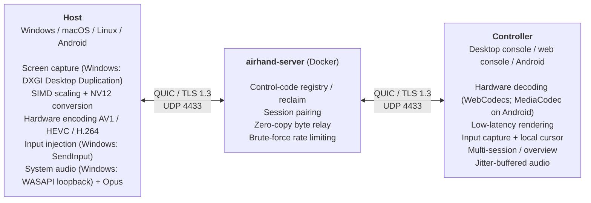

# How it works

[← Back to README](../README.md) · [简体中文](architecture.zh-CN.md)

## Architecture

For how the host is implemented on each platform, see the [table below](#the-host-on-each-platform).

The first bidirectional stream on every QUIC connection is the **control stream** (signaling). For each remote-control session both sides open three bidirectional streams (session control, video and audio); the server pairs them by session ID and lane, then **only forwards bytes, it never parses the video**. This is protocol v8: update the server and all clients together. Ordering is guaranteed within each lane, not across lanes; capture timestamps synchronize audio and video. Every message is a `u32` length prefix followed by a postcard-encoded payload. When a controller reconnects it presents the resume token it got when it connected; if the host is offline the server remembers the request and sends `HostOnline` when the host is back (see "Resume tokens" in `crates/airhand-proto/src/signal.rs`).

On the session control stream the controller first sends a random ID for this run of the app; the host answers with `Hello` (platform, whether it accepts multi-touch, which system actions it supports) and starts sending video. A host may first answer "awaiting approval" and send `Hello` only after the person at it allows the connection (Android does by default; see the module docs of `crates/airhand-proto/src/session.rs`).

The web console splits the controller on the right in two: the QUIC connection and session handling run in `airhand-web` (the container), while decoding, rendering and input capture stay in the browser, with one WebSocket in between. Packets are forwarded to the browser unchanged (with a 4-byte session number in front), and the browser acknowledges the frames.

The desktop WebView also acknowledges frames after the IPC hop. Controller commands are bounded to 128 messages / 2 MiB, with adjacent mouse movement and superseded state coalesced. Overflow or commands older than two seconds end the session instead of replaying stale operations. WebSocket output has both a message limit and a 32 MiB byte budget.

Fixed codes are queried from an in-memory index. A dedicated SQLite worker coalesces updates per code; registration waits for persistence outside broker locks before publishing, and shutdown also flushes. Disk failures retain in-memory ownership and retry, never treating a failed lookup as an unowned code. A persistence-barrier timeout is logged and service continues in memory; a forced exit can then lose uncommitted updates.

### Source layout

| Directory | Contents |
|---|---|
| `crates/airhand-proto` | Protocol: signaling, session messages, framing |
| `crates/airhand-link` | The client side of the relay link: QUIC, certificate pinning, reconnects, UI-independent controller sessions, `Problem`. Shared by the desktop client and the web console |
| `server/` | Relay server (quinn + rustls) and its `Dockerfile` |
| `web/` | Web console service (axum: static files + WebSocket, HTTP and HTTPS on one port), its `Dockerfile` and `docker-compose.yml`. A separate Cargo workspace, like `client/src-tauri/` |
| `client/src-tauri/` | Desktop client, Rust side: host `host/`, tray, console window and commands |
| `android/native/` | Android Rust core (JNI): the controller uses `airhand-link`; the host's network side (registering / reclaiming the code, sessions, in-flight frame control and adaptive bitrate, same as the desktop). A separate Cargo workspace like `client/src-tauri/` and `web/` |
| `android/app/` | Android app (Kotlin + Jetpack Compose): phone and TV interfaces, MediaCodec decoding / encoding, screen recording, accessibility service (remote control) |
| `client/src/` | `lib/session.ts` manages sessions, `connection-attempt.ts` isolates connection generations, `video.ts` owns decoding / video queues, `input.ts` owns input; console UI (React 19 + TypeScript, no UI library), shared by the desktop and web consoles, which differ only in `client/src/lib/backend/`; strings in `client/src/locales/` |
| `assets/icon.svg` | Application icon source |

### The host on each platform

On Windows all of this runs in the system service (see [Windows service](#windows-service)):

| Stage | Windows | macOS | Linux (X11) | Android |
|---|---|---|---|---|
| Screen capture | DXGI Desktop Duplication | ScreenCaptureKit | MIT-SHM shared memory + DAMAGE change notifications; RandR for multiple monitors | MediaProjection (a virtual display rendering straight into the encoder) |
| Cursor shape | DXGI | NSCursor | XFIXES | — |
| Video encoding | Media Foundation hardware encoders, OpenH264 fallback | VideoToolbox hardware encoders (H.264 / HEVC), OpenH264 fallback | OpenH264 | MediaCodec (hardware encoders preferred) |
| Input injection | SendInput (scan codes) | CGEvent (virtual key codes) | XTEST (evdev physical key codes) | Accessibility service (gestures, system actions, text input) |
| Audio capture | WASAPI loopback | ScreenCaptureKit (system mix) | PulseAudio / PipeWire output monitor | AudioPlaybackCapture (Android 10+) |
| Clipboard | Change detection via the clipboard sequence number | NSPasteboard change count | XFIXES selection-owner change notifications | Write only (controller → phone) |
| Console UI | WebView2 | WKWebView | WebKitGTK (WebCodecs decoding via GStreamer) | Jetpack Compose (MediaCodec decoding) |

## Windows service

The same `airhand.exe` plays several roles depending on its command line (`client/src-tauri/src/winsvc/`):

| Process | Runs as | Does |
|---|---|---|
| `airhand.exe` | the signed-in user | Tray and console |
| `airhand.exe --service` | SYSTEM, session 0 | The Airhand service: starts the host in the console session (the one at the physical screen) and watches it; moves it when the console session changes (switching users, signing out) and restarts it if it exits |
| `airhand.exe --agent` | SYSTEM, console session | The host: server connection, capture, encoding, input, audio, clipboard |
| `airhand.exe --install` / `--uninstall` / `--stop-service` | administrator | Called by the installer |

- Desktop Duplication and `SendInput` only work on the desktop the calling thread is on. UAC prompts, the lock screen and the sign-in screen are on the secure `Winlogon` desktop, which only SYSTEM can open; the capture and input threads switch to whichever desktop currently receives input before using it (`client/src-tauri/src/host/desktop.rs`)
- The tray and the host talk over a named pipe per session (`\\.\pipe\airhand-host-<session>`), one JSON message per line. Only interactive users can connect, they can't open another instance of the pipe to impersonate the host, and the tray checks that the pipe belongs to SYSTEM
- The service and the host have no console: they log with `OutputDebugString` (see [Debugging the Windows service](development.md#debugging-the-windows-service))

## Video

| Stage | How it works |
|---|---|
| Capture | Frames are only produced when the screen changes (DXGI on Windows, ScreenCaptureKit on macOS, DAMAGE on X11), so an idle desktop uses almost no bandwidth |
| Refinement when still | A frame with a large change (switching windows, scrolling) only gets about one frame's worth of bitrate, so text comes out blurry. 200 ms after the screen stops changing, the last frame is encoded a few more times; the encoder only has to code the residual, so within a few frames it is close to the original (until the encoder has nothing meaningful left to add, at most 8 frames), then nothing more is sent |
| Preprocessing | `fast_image_resize` (SIMD, Catmull-Rom) for scaling, split into horizontal stripes scaled on several cores at once (scaling is on every frame's critical path: on an Apple M1, 2880×1800 → 1080p drops from about 18 ms to about 9 ms, pixel-identical to scaling the whole image), `yuvutils-rs` (AVX2) for BGRA→NV12/I420; all buffers are reused |
| Encoding | **Hardware first**: Media Foundation hardware encoders (NVENC / Quick Sync / AMF) for **AV1 / HEVC / H.264**, low-latency mode, no B-frames, very long GOP; on macOS VideoToolbox (H.264 / HEVC, low-latency rate control for H.264). Without one it falls back to **OpenH264 in screen-content mode**. Formats are ranked **AV1 > HEVC > H.264**; the most efficient one both sides support (the host can encode, the controller can decode) is picked automatically |
| Rate control | The controller ACKs every frame. The host caps the number of **in-flight frames** (≈ RTT × fps + 2); on a slow network it waits and **skips to the newest frame** instead of building up lag. Adaptive bitrate steps down under congestion and recovers gradually |
| Transport | QUIC with **BBR**. Control, audio and video use separate bounded queues and QUIC streams, avoiding video stream head-of-line blocking. Connection bandwidth is still shared; the web console's final hop remains a single WebSocket |
| Decoding | The controller decodes on the GPU with **WebCodecs** (`optimizeForLatency`) and paints straight into a `desynchronized` Canvas |
| Display | The picture is **scaled only once**: the controller requests the resolution the picture actually occupies in the window, in device pixels (never above the user's cap), the host scales straight to it, and the controller shows it 1:1 aligned to device pixels (see `client/src/lib/fit.ts`). A second scaling in the browser (especially by a factor close to 1, or at half-pixel offsets) makes text blurry |
| Cursor | The remote cursor's **shape** is mirrored to the local cursor and movement is handled locally, so there is **no perceptible cursor lag** |
| Background sessions | Sessions that aren't on screen drop to 5 fps |

Measured locally (RTX GPU, 4K display output at 1080p): hardware AV1 encodes a frame in about 7 ms, H.264 in about 9 ms; OpenH264 software encoding takes about 40 ms.

## Audio

The host's system sound (not the microphone) is streamed to the controller:

| Stage | How it works |
|---|---|
| Capture | Loopback capture of the default output device, converted to 48 kHz stereo; follows the default device when it changes (e.g. you plug in headphones) |
| Encoding | Opus at 96 kbps, 20 ms per packet; **no packets during silence** |
| Transport | Independent audio QUIC stream, prioritized below control and above video; a full queue drops packets rather than blocking capture |
| Playback | WebCodecs decoding → AudioWorklet adaptive jitter buffer: about 40 ms on a stable network, growing under jitter and shrinking back once stable. A ±1–2% speed adjustment cancels the clock drift between the two sound cards, and a large backlog is skipped |

Only the session you are looking at plays audio (none do in the multi-screen overview); the other hosts are told to stop capturing.

When the host can't capture sound (no audio output device, or no PulseAudio / PipeWire running on Linux, for example), the controller shows a message, the speaker in the toolbar gets a yellow dot and the sound menu gives the reason. The host retries every 2 seconds, and the message goes away once it recovers.

## A/V sync (optional, off by default)

Audio goes through a jitter buffer while video is shown as soon as it arrives, so by default audio lags video slightly: about **70 ms** in our measurements (same machine, local relay, 4K output at 1080p; 49–78 ms per run). That's barely noticeable while working, but may be when watching video.

With **A/V sync** turned on (speaker menu in the toolbar):

- Video frames and audio packets both carry the host's capture time on the same clock (DXGI present time and WASAPI QPC timestamps). The controller measures the capture → display/playback latency of each stream separately; **the clock offset between the two computers cancels out**, so no time sync is needed
- Normally each frame is delayed until it lines up with the audio. If the video is the slower one (tight bandwidth), the audio is buffered longer instead (up to 300 ms); a single slow frame doesn't trigger this
- Measured residual offset: **−3 to −4 ms** on average (negative = audio slightly early), worst case −31 ms, inside the range generally considered imperceptible (audio ahead by up to about 45 ms)
- Trade-off: video appears about 70 ms later, so typing and dragging feel slower; it suits watching video, not working. The cursor is drawn locally and is unaffected. The toolbar shows "Sync +N ms"

The delay from painting to the Canvas to the pixels lighting up is estimated at 8 ms (not measured with a camera).

## Files on disk

- Everything Airhand saves (settings, this computer's control code, My devices) is in one `config.toml` (see [Configuration file](usage.md#configuration-file)). Logs never go to files: stderr, or `OutputDebugString` for the Windows service
- Host mode **doesn't create a WebView**, so it creates no files at all
- The single-instance lock is a kernel object, not a lock file: a named mutex on Windows, an abstract-namespace Unix socket on Linux, a Mach port name registered with the bootstrap server on macOS
- The console's WebView needs a data directory: it lives in a random subdirectory of the temp directory, runs in private mode (no cookies or cache saved), and is deleted when the window closes or the program exits. If the process is killed, leftovers are removed on the next start. On macOS WKWebView needs no data directory and writes nothing to disk in private mode
- On Linux, the few things that can only be handed over as files (the tray icon for AppIndicator, WebKitGTK's GStreamer plugin cache) live in a random per-process directory under `XDG_RUNTIME_DIR` (a RAM disk) that is removed on exit, including on SIGTERM / SIGINT. The Mesa / NVIDIA on-disk shader caches are turned off
- Other console settings (the UI language, closed tabs…) live in memory only
- Android: settings, saved devices and the phone's control code are only stored in the app's private directory, never backed up or transferred, and removed by the system on uninstall (see [Where the data is stored](android.md#where-the-data-is-stored))
- All of the above is about the desktop client. The web console is a service you deploy: it keeps its self-signed HTTPS certificate in `web/data/`, and the browser also keeps settings in memory only; My devices isn't saved there and is cleared when the page reloads (plus a session cookie when a password is set)
