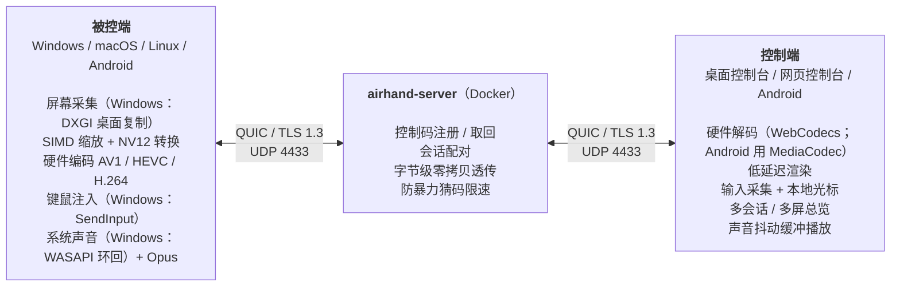

# 工作原理

[← 返回 README](../README.zh-CN.md) · [English](architecture.md)

## 架构

被控端各平台的具体实现见[下面的表](#被控端在各平台上的实现)。

每条 QUIC 连接上的第一条双向流是**控制流**（信令）。每建立一个远控会话，双方各再开一条双向流，服务器按会话 ID 把两条流配对，之后**只转发字节、不解析画面**。每条消息是 `u32` 长度前缀加 postcard 编码的内容。控制端重连时带上连上时得到的重连凭证；被控端不在线时服务器记下它，被控端重新上线时发 `HostOnline` 通知（见 `crates/airhand-proto/src/signal.rs` 的“重连凭证”）。

会话流上控制端先报上本次运行的随机标识，被控端回 `Hello`（平台、能不能接收多点触摸、支持哪些系统操作），之后开始发画面。被控端也可以先回“等待同意”，请坐在它面前的人允许之后再发 `Hello`（Android 默认这样，见 `crates/airhand-proto/src/session.rs` 的模块说明）。

网页控制台把右边的控制端拆成两半：QUIC 连接和会话管理在 `airhand-web`（容器）里，解码、渲染、输入采集仍在浏览器里，两者之间是一条 WebSocket。画面原样转发给浏览器（每个数据包前面加 4 字节的会话编号），浏览器收到后回确认。

### 代码目录

| 目录 | 内容 |
|---|---|
| `crates/airhand-proto` | 协议：信令、会话消息、帧格式 |
| `crates/airhand-link` | 客户端到中转服务器的链路：QUIC 连接、证书固定、断线重连，与界面无关的控制端会话，`Problem`。桌面客户端和网页控制台共用 |
| `server/` | 中转服务器（quinn + rustls）及其 `Dockerfile` |
| `web/` | 网页控制台服务（axum：静态网页 + WebSocket，HTTP / HTTPS 同一端口）及其 `Dockerfile`、`docker-compose.yml`。和 `client/src-tauri/` 一样是独立的 Cargo 工作区 |
| `client/src-tauri/` | 桌面客户端 Rust 部分：被控端 `host/`、托盘、控制台窗口和命令 |
| `android/native/` | Android 的 Rust 核心（JNI）：控制端用 `airhand-link`；被控端的网络部分（注册 / 取回控制码、会话、在途帧控制和自适应码率，与桌面版相同）。和 `client/src-tauri/`、`web/` 一样是独立的 Cargo 工作区 |
| `android/app/` | Android 应用（Kotlin + Jetpack Compose）：手机和电视界面、MediaCodec 解码 / 编码、屏幕录制、无障碍服务（远程操作） |
| `client/src/` | 控制台界面（React 19 + TypeScript，不依赖 UI 库），桌面版和网页版共用，区别只在 `client/src/lib/backend/`；文案在 `client/src/locales/` |
| `assets/icon.svg` | 应用图标源文件 |

### 被控端在各平台上的实现

Windows 上这些都运行在系统服务里（见 [Windows 服务](#windows-服务)）：

| 环节 | Windows | macOS | Linux（X11） | Android |
|---|---|---|---|---|
| 屏幕采集 | DXGI Desktop Duplication | ScreenCaptureKit | MIT-SHM 共享内存 + DAMAGE 变化通知，RandR 多显示器 | MediaProjection（虚拟显示器直接输出到编码器） |
| 光标形状 | DXGI | NSCursor | XFIXES | — |
| 视频编码 | Media Foundation 硬件编码，OpenH264 兜底 | VideoToolbox 硬件编码（H.264 / HEVC），OpenH264 兜底 | OpenH264 | MediaCodec（优先硬件编码器） |
| 输入注入 | SendInput（扫描码） | CGEvent（虚拟键码） | XTEST（evdev 物理键码） | 无障碍服务（手势、系统操作、文字输入） |
| 声音采集 | WASAPI 环回 | ScreenCaptureKit（系统混音） | PulseAudio / PipeWire 的输出监视器 | AudioPlaybackCapture（Android 10+） |
| 剪贴板 | 剪贴板序号检测变化 | NSPasteboard 变化计数 | XFIXES 选择所有者变化通知 | 只能写入（控制端 → 手机） |
| 控制台界面 | WebView2 | WKWebView | WebKitGTK（WebCodecs 由 GStreamer 解码） | Jetpack Compose（MediaCodec 解码） |

## Windows 服务

同一个 `airhand.exe` 按命令行参数扮演不同的角色（`client/src-tauri/src/winsvc/`）：

| 进程 | 身份 | 做什么 |
|---|---|---|
| `airhand.exe` | 登录的用户 | 托盘和控制台 |
| `airhand.exe --service` | SYSTEM，会话 0 | 系统服务 Airhand：在控制台会话（物理屏幕前的那个会话）里启动被控端并看护它；控制台会话变了（切换用户、注销）就把它挪过去，退出了就重新启动 |
| `airhand.exe --agent` | SYSTEM，控制台会话 | 被控端：连接服务器、采集、编码、注入键鼠、声音、剪贴板 |
| `airhand.exe --install` / `--uninstall` / `--stop-service` | 管理员 | 安装程序调用 |

- 桌面复制和 `SendInput` 只对调用线程所在的桌面有效。UAC 确认框、锁屏和登录界面在安全桌面 `Winlogon` 上，只有 SYSTEM 能打开；采集线程和注入线程在用之前先切到当前接收输入的桌面上（`client/src-tauri/src/host/desktop.rs`）
- 托盘和被控端之间是每个会话一个的命名管道（`\\.\pipe\airhand-host-<会话>`），每行一条 JSON 消息。只有交互登录的用户能连接，不能再开一个同名管道实例冒充被控端，托盘还会核对管道属于 SYSTEM
- 服务和被控端没有控制台：日志用 `OutputDebugString` 输出（见开发文档的[调试 Windows 服务](development.zh-CN.md#调试-windows-服务)）

## 画面

| 环节 | 做法 |
|---|---|
| 采集 | 只在画面变化时产生帧（Windows 靠 DXGI，macOS 靠 ScreenCaptureKit，X11 靠 DAMAGE），静止的桌面几乎不占带宽 |
| 预处理 | `fast_image_resize`（SIMD）缩放，`yuvutils-rs`（AVX2）BGRA→NV12/I420，缓冲区全部复用 |
| 编码 | **硬件优先**：Media Foundation 硬件编码器（NVENC / Quick Sync / AMF），支持 **AV1 / HEVC / H.264**，低延迟模式、无 B 帧、超长 GOP；macOS 上是 VideoToolbox（H.264 / HEVC，H.264 用低延迟码率控制）；没有硬件编码器时回退到 **OpenH264 屏幕内容模式**。格式按 **AV1 > HEVC > H.264** 的优先级，自动选用双方都支持（对方能编码、本机能解码）的里压缩率最高的 |
| 码率控制 | 控制端每帧都回 ACK，被控端限制**在途帧数**（≈ RTT × 帧率 + 2），网络慢时等待并**跳到最新一帧**，不会越积越卡；自适应码率按拥塞情况下调，恢复后逐步回升 |
| 传输 | QUIC + **BBR** 拥塞控制（Wi-Fi、跨境这类丢包网络下比 Cubic 稳）；控制消息、声音、画面分开排队，Ping 和鼠标不会排在大帧后面 |
| 解码 | 控制端用 **WebCodecs** GPU 解码（`optimizeForLatency`），解完马上画到 `desynchronized` Canvas |
| 光标 | 远端光标的**形状**同步到本地光标，移动在本地完成，**感觉不到延迟** |
| 后台会话 | 不在屏幕上的会话自动降到 5 fps |

本机实测（RTX 显卡，4K 屏输出 1080p）：硬件 AV1 每帧编码约 7 ms，H.264 约 9 ms；OpenH264 软件编码约 40 ms。

## 声音

被控端的系统声音（不含麦克风）会同步到控制端：

| 环节 | 做法 |
|---|---|
| 采集 | 环回采集默认输出设备，转换为 48 kHz 立体声；默认设备变化（例如插上耳机）时自动跟随 |
| 编码 | Opus 96 kbps，每包 20 ms；**没有声音时不发包** |
| 传输 | 与画面同一条流，排在控制消息之后、画面之前；队列满时直接丢包，不会越积越慢 |
| 播放 | WebCodecs 解码 → AudioWorklet 自适应抖动缓冲：稳定网络约 40 ms，抖动时自动加大、稳定后回落；用 ±1~2% 的变速抵消两端声卡的时钟偏差，积压过多时直接跳过 |

只有当前正在看的会话播放声音（多屏总览时都不播放），其它被控端会被通知停止采集。

被控端采集不到声音时（例如没有声音输出设备、Linux 上没有运行 PulseAudio / PipeWire），控制端会显示提示，工具栏的喇叭上有黄点，声音菜单里也写着原因；被控端每 2 秒重试一次，恢复后提示自动消失。

## 音画同步（可选，默认关闭）

声音要经过抖动缓冲，画面则是一到就显示，所以默认声音会比画面晚一点：实测约 **70 ms**（同机、本地中转、4K 屏输出 1080p；单次 49~78 ms）。操作电脑时几乎察觉不到，看视频时可能会。

在工具栏的喇叭菜单里打开**音画同步**后：

- 画面帧和声音包都带有被控端同一个时钟上的采集时间（DXGI 的呈现时间、WASAPI 的 QPC 时间戳），控制端分别测出两条流“采集 → 显示 / 播放”的延迟，**两台电脑之间的时钟差会相互抵消**，不需要对时
- 通常把每一帧推迟到与声音对齐再显示；如果画面反而更慢（带宽紧张），就让声音多缓冲一会儿去等画面（最多 300 ms），偶尔一帧慢不会触发
- 实测残余音画差平均 **−3~−4 ms**（负数 = 声音略早），最大 −31 ms，在一般认为察觉不到的范围内（声音提前不超过约 45 ms）
- 代价：画面晚约 70 ms 显示，打字、拖动窗口会觉得变慢，所以适合看视频、不适合操作；鼠标指针是本地绘制的，不受影响。工具栏会显示“同步 +N ms”

画到 Canvas 之后到屏幕真正亮起来的时间按 8 ms 估算（没有用摄像头实测）。

## 磁盘上的文件

- Airhand 要保存的东西（设置、本机的控制码、我的设备）都在一个 `config.toml` 里（见[配置文件](usage.zh-CN.md#配置文件)）。日志从不写文件：写到 stderr，Windows 服务写到 `OutputDebugString`
- 被控端模式**不创建 WebView**，不会产生任何文件
- 单实例锁用的是内核对象而不是锁文件：Windows 是命名互斥量，Linux 是抽象命名空间的 Unix 套接字，macOS 是登记在 bootstrap 服务里的 Mach 端口名
- 控制台的 WebView 需要数据目录：放在临时目录下的随机子目录，开启隐私模式（不保存 Cookie 和缓存），关闭窗口或退出程序时删除；进程被强制结束时，下次启动会清理残留。macOS 的 WKWebView 不需要数据目录，隐私模式下完全不写磁盘
- Linux 上几样只能以文件形式交出去的东西（交给 AppIndicator 的托盘图标、WebKitGTK 的 GStreamer 插件缓存）放在 `XDG_RUNTIME_DIR`（内存盘）里本进程专用的随机目录，退出时删除（收到 SIGTERM / SIGINT 也一样）；Mesa / NVIDIA 的着色器磁盘缓存直接关闭
- 控制台的其它设置（界面语言、关闭的标签……）只保存在内存里
- Android：只在应用自己的私有目录里保存设置、连接过的设备和本机的控制码，不备份、不迁移，卸载时由系统全部删除（见[数据保存在哪里](android.zh-CN.md#数据保存在哪里)）
- 以上说的是桌面客户端。网页控制台是部署在服务器上的服务：它把自签名的 HTTPS 证书存在 `web/data/` 里，浏览器那边也只在内存里保存设置，我的设备不保存、刷新页面后清空（登录密码时会有一个会话 Cookie）
