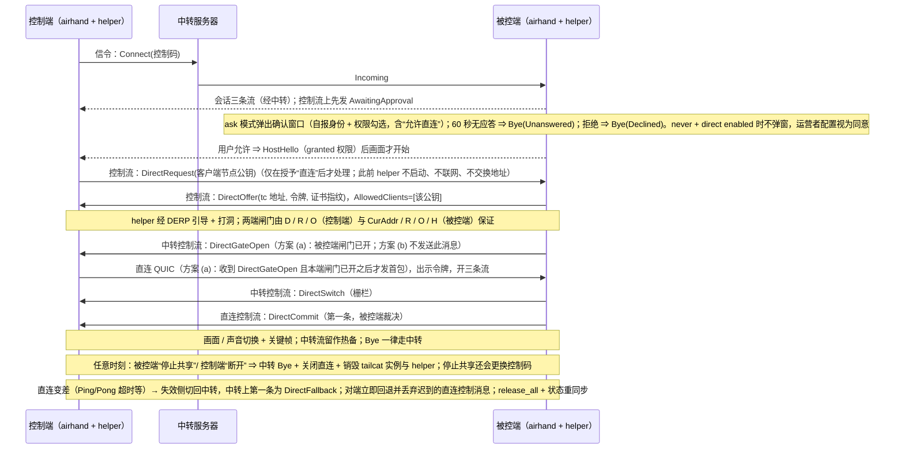

# tailcat 临时点对点直连：feature map

> 与 [`tailcat-p2p.md`](tailcat-p2p.md) 配套。基线：`sqlpxc/airhand` `main` @ `a317551`；tailcat 固定 `v0.7.0`（commit `15ab9e6`）。
> 状态：规格 r6.5.2（2026-11-11 Asia/Taipei：在 r6.5.1 之上处理第 10 轮针对性复审〔有条件通过，S1 = 0、S2 = 4、S3 = 13〕，2026-11-11 Friday 按授权决定；r6.5.1 在 r6.5 之上写入 Friday 21:23 的补充决定；r6.5 是第 9 轮复审〔有条件通过，S1 = 0、S2 = 9、S3 = 13〕后的修订，不再做整轮复审）。决定的归属分三类：**Jack 2026-11-11 决定**——真机 soak 与随机丢包判据只记录（#51 在 400 / 500 / 700 ms 下也只记录）、OQ-23 测量补丁从 `957c4ac` 另开分支且不进 PR #8、不合并、OQ-24b：A；**2026-11-11 Friday 按授权决定**（Jack 可推翻）——OQ-17–OQ-19、OQ-21、OQ-22、OQ-25、OQ-20a、OQ-20b、OQ-24a（接受 H 边缘情形的 J_min 豁免、不收紧 H）、wanemu 测量补丁、不采纳 `ack_stall_ms` 1100 与探测周期 100 ms；**r6.5.1（21:23 补充决定，同样标“2026-11-11 Friday 按授权决定”）**——soak 与随机丢包类用例（含 #11、#51 的随机变体）只记录、预言机判定也只写入记录、确定性用例照常断言；心跳携带 `epoch` 与连接号保留；OQ-28 不引入心跳时间戳与 O 的一次性定时器；OQ-23c 取 P2、OQ-23d：spike 与测量补丁放在自 `957c4ac` 另开的分支；落入仓库时同一分支三个提交；先红须是断言失败；**Jack 2026-11-11 决定（21:35）**——OQ-26：接受握手窗口“首个入站晚于断路”的子情形（约 3.2 s）为 I3 的例外，规格披露，测试与真机先只记录；**Jack 2026-11-11 决定（21:36）**——OQ-27（原话：“被控端也执行重试上限，补用例并做针对性复审”）；累计最多 3 次、间隔 30 s、与 OQ-20b 一致、不引入新阈值是经 Friday 转述，#146–#148 与判定细节是对决定的落地（Friday 按授权决定）；**没有新的待 Jack 决定项**（OQ-15、OQ-16 沿用 r6；OQ-26、OQ-27 的备选方案在 评审交接文档 `open-questions-r6.5.2.md`（未入库），已关闭）。承接 r6.4 / r6.3 / r6.2 / r6.1 / r6（2026-11-10 14:30 Asia/Taipei：写入 Phase 0 五项前提、C = 100 Mbps、I3 窗口包数上限与 never 已知风险；真机测试为批准 (B) 的前提。r6.1 闭合第 6 轮 S1 并落实复审 S2）。未实现。基线备注：r5 已随 PR #1 合入本 fork 的 `main`（`b24a671`）；r6 规格、先红测试与 spike 现都在整合 PR #8（https://github.com/2mauis/airhand/pull/8 ，head `c0fdff6`，分支 `feat/tailcat-p2p`）里，本文件随其上的 r6.5.1 修订。

## 能力 → 组件 → 阶段

| # | 能力 | 涉及组件 / 文件（现有或新增） | 阶段 | 验收（用例名见 spec） |
|---|---|---|---|---|
| F1 | 配置开关与默认关闭 | `client/src-tauri/src/config.rs`（`[direct]`） | 1 | `direct_config_*`（r6.3：含 `rx_silence_ms`、`ack_stall_ms`、`handshake_watchdog_ms` 越界被拒）、`disabled_by_default_never_spawns_helper`、`direct_config_rejects_rx_silence_out_of_range`、`direct_config_rejects_ack_stall_out_of_range`、`direct_config_rejects_handshake_watchdog_out_of_range` |
| F2 | 能力位协商 | `crates/airhand-proto/src/session.rs`（`HostHello` / `ControllerHello`） | 1 | `direct_messages_wire_is_stable`、`protocol_version_is_10`、`peer_without_direct_enabled_stays_on_relay` |
| F3 | 协议版本 9→10，握手编码不变 | `crates/airhand-proto/src/lib.rs`、`framing.rs` | 1 | `version_handshake_wire_is_stable` |
| F4 | `DirectRequest` / `DirectOffer`（`kind`+不透明 `body`）/ `DirectDecline` / `DirectCommit` / `DirectSwitch`（升级栅栏）/ `DirectFallback`（回退反向栅栏）/ `DirectGateOpen`（方案 (a) 的被控端闸门打开提示，I24） 控制消息 | `crates/airhand-proto/src/session.rs` | 1 | 同上、`request_before_host_hello_is_dropped`、`unknown_offer_kind_is_declined`（I8 以 `DirectDecline` 协商，不依赖解码器容忍未知变体）、`first_quic_initial_not_lost_to_host_gate`、方案 (a) 的 `controller_waits_for_direct_gate_open_before_first_quic` / `host_sends_direct_gate_open_when_gate_opens` / `late_or_mismatched_direct_gate_open_is_ignored`、方案 (b) 的入站缓存用例 |
| F5 | helper：tailcat 单 UDP 端口 ⇄ Rust 数据报通道（回环 UDP 或独立管道，(i)/(ii) 等 Windows 真机结论后再选定）；包过滤显式配置（TCP 空非 nil、单 UDP 端口）；`AllowedClients` 在 `Start` 前给定；路径闸门双向，**控制端三个、被控端四个关闭条件（r6.3 修订）**；**握手完成后**默认阈值下先到者 ≤ 1575 ms 的结论只对握手完成后成立（r6.5，S3-3）：控制端 D（流水线 `DiscoPing`，M = 3，`T_p = clamp(3×sRTT, 750, 950) ms`，不得串行、不得用 `Client.Ping`）+ R（入站静默）+ O（出站确认看门狗）；被控端 `Server.Status()` 的 `CurAddr` 为空 + R + O + **H（握手看门狗，helper 内计时，默认 1500 ms，只放弃本次尝试、不使会话失败）**；R 默认 1000 ms（范围 1000–1200，计时从首个入站之后开始，关闭粘性）、O 默认 `ack_stall_ms` 1000 ms（范围 1000–1100；**信号 = 探测流被新确认，禁止 ACK 帧计数**）；RTT ≤ 400 ms 下默认阈值先到者 ≤ 1575 ms、每个条件上界 ≤ 1700 ms（最小抖动余量 300 ms；**H 的“断路先于首个入站”边缘情形除外：≤ 1910 ms，余量 90 ms，P_H = 10 ms，J_min 豁免，r6.4**；推导值，见规格 §2，未实测）；O 的计时器在 helper 内（r6.4：Rust 只发进展心跳，握手完成时起算并撤销 H；**r6.5：心跳送达 helper ≤ 50 ms 是假设，Rust 停顿超出的部分推后关闸并从 J_min 里扣，上界 1575 + max(0, X − 50) ms；心跳带 `epoch` 与连接号，不匹配的忽略〔既有机制澄清，Friday 按授权保留〕；OQ-28：不引入心跳时间戳 / O 的一次性定时器，实测只记录**）；D、O 的保证突发容忍度 < 250 ms、R < 500 ms（r6.4 重算）；被控端在“仅被控端→控制端不通”时 O 是**唯一**的 2 s 内条件；**握手窗口“首个入站晚于断路”的子情形约 3.2 s、超出 2 s，已接受为 I3 的例外（r6.5，S2-1；Jack 2026-11-11 决定，OQ-26 关闭；#143 变体 F 与真机对应相位先只记录）**；H 的 J_min 豁免由 2026-11-11 Friday 按授权决定接受（H 及其范围是 r6.3 的 Friday 决定，不是已批准阈值，r6.5，S2-5）；K 驱动仅在提交之后且升级阶段仍须保留静默；自建 DERP 上“直连 QUIC 握手已完成、有数据流”的稳定直连，最长关闭时限下窗口数据包上限为 0（OQ-24b：Jack 2026-11-11 决定：A；“有数据流”含 keep-alive、探测流与 Ping/Pong）；写超时看门狗（默认 500 ms，I25，超时则重启 helper 进程） | 新增 `p2p/`（Go 模块，依赖 tailcat `v0.7.0`） | 1 | `TestServesExactlyOneUDPPort`、`TestNoTCPServiceAndNoRST`、`TestOnlyAllowedClientKeyConnects`、`TestEmptyOrInvalidAllowlistRefusesToStart`、`TestGateDropsWhenPathNotDirect`、`TestHostGateClosesOnRxSilence`、`TestHostGateRxSilenceNotArmedBeforeFirstInbound`、`TestHostGateSilenceCloseIsStickyInEpoch`、`TestHostGateWindowZeroPacketsOnSelfHostedDerp`、`TestHostGateRxSilenceActiveBeforeCommit`（r6.2 由 `TestKDrivenGateStillSilentBeforeCommit` 改名；K 专属版本为条件用例）、`TestWriteTimeoutReportsPathFailure`、`TestClientPingMustNotBeUsedForPath`、`TestControllerGateClosesWithin2sAtRtt400Ms`（r6.3：只断言 D + R 的上界）、`TestControllerGateClosesOnRxSilenceIndependentOfRtt`、`TestControllerDiscoPingsArePipelined`、`TestHelperClosesGateOnRustCommandWithinIPCBound`、`TestHostGateClosesWithin2sAtRtt400Ms`、`TestDiscoPingConcurrentCallsAreSafe`（PV-1，先于实现 D 的 PR 通过）、`TestWindowCountDetectsLeakWhenGateClosesLate`、`TestNegativeAssertionsFailOnNoopGate`、`TestGateStaysOpenWithKeepAliveDatagramsAndNoPing`、`TestPublicKeyBeforeOfferMakesNoNetworkActivity`、`TestSchemeAControllerSendsNothingBeforeGateOpenAndUpgradeCompletes`、`TestWriteStallReportedByIndependentTimer`、`TestHostHandshakeWatchdogClosesGateWithoutRustCommand`、`TestControllerDiscoPingDeadlineIsClamped`、`TestGateBurstLossToleranceAndTrip`、`TestControllerGateClosesWithin1700msInHandshakeWindow`、`TestHelperNeverCallsAddAllowedClient`、`TestHelperAckWatchdogClosesGateWithoutRustCommand`、`TestHostHandshakeWatchdogEdgePhaseWithin1910ms` |
| F6 | helper 控制协议（stdin/stdout JSON 行，地址不进 argv；r6.2：helper 事件与错误只带路径类别、计数、写进度心跳与原因类别码，不带端点或 Go 错误原文，Rust 不把 helper stderr 原样写日志） | `p2p/`、`crates/airhand-link`（新增 `direct/` 模块：子进程监督、IPC） | 1 | `TestControlProtocolNeverEchoesAddressToArgvOrStderr`、`direct_secrets_are_redacted_in_debug_and_logs`（`Secret<T>`）、`helper_hash_mismatch_disables_direct`、`TestHelperEventsAndErrorsContainNoEndpoint`、`TestTailcatLogfDiscardedByDefault`、`helper_stderr_not_logged_verbatim`、`verification_string_not_logged`、`helper_progress_silence_triggers_restart` |
| F7 | 被控端直连 QUIC 监听（视候选：仅回环 UDP 或无本机端口）+ 一次性令牌 + 临时证书 | `crates/airhand-link/src/host.rs`、`transport.rs`、`net.rs`（复用证书固定） | 1 | `direct_token_*`、`direct_cert_pin_mismatch_aborts_upgrade`、`direct_listener_binds_loopback_only` / `direct_path_opens_no_local_port`（视候选） |
| F8 | 直连路径 QUIC 参数（载荷 ≤ 1232，关 PMTU 上调） | `crates/airhand-link/src/net.rs`（新 `direct_transport_config()`；r6.3：`max_concurrent_uni_streams` ≥ 32（r6.4，S3-9）供 O 的探测流使用，探测流最高发送优先级，`direct_transport_config()` 是中转 `transport_config()` 的独立副本，中转用的 `transport_config()` 保持 0） | 1 | `direct_quic_never_sends_datagram_over_1232`、`ack_probe_streams_are_accepted_and_do_not_exhaust_stream_limit` |
| F9 | 升级状态机：被控端裁决提交（`DirectCommit`）、升级栅栏与回退反向栅栏、I24 首包保护（DirectGateOpen 或入站缓存）、热备、关键帧、去重、回退后 `release_all()` 与状态重同步 | `crates/airhand-link/src/host.rs`、`controller/session.rs`、`transport.rs` | 1 | `session_upgrades_to_direct_*`、`first_quic_initial_not_lost_to_host_gate`、`host_fence_then_commit_is_first_direct_message`、`input_order_preserved_across_switch`、`fence_timeout_drops_buffer_and_releases_keys`、`late_direct_input_after_fallback_is_discarded`、`keys_released_after_fallback`、`settings_resynced_after_fallback`、`controller_resends_cached_settings_audio_display_after_fallback`、`duplicate_frames_*`、`stale_lane_frames_*`、`fallback_then_reupgrade_uses_new_epoch_and_new_process` |
| F10 | 健康检测与回退（r6.3：闸门由控制端 D / R / O 与被控端 CurAddr / R / O / H 保证 ≤ 2 s，含 RTT 400 ms、单向断路与握手窗口；H 放弃只退回中转；**r6.4：闸门打开之后、提交之前的放弃（H / D / R / O / CurAddr / 提交等待超时）进入重试期并计 1 次，从未达到 direct 的失败不重试〔OQ-20a、OQ-20b 均为 2026-11-11 Friday 按授权决定；r6.5：判据只有一个——控制端闸门是否曾打开，含“闸门已开、等不到 `DirectGateOpen` 的升级超时”（S3-8）；被控端也按会话执行同一上限〔Jack 2026-11-11 决定，OQ-27；#146–#148〕〕**；重试期规则：每 30 s 一次直到成功或累计 3 次；存活检测 K 只负责回退，被控端 K 从首个直连 `Ping` 起算；整个会话最多 3 次尝试，从未达到 direct 的初次失败默认不重试〔OQ-20a〕；自建 DERP 上稳定直连时窗口数据包为 0）；写超时即回退并重启 helper（I25）；直连会话码率达上限 C 时限制码率、不回退（I26；C=100 Mbps 为暂定值，须按 k=0.5 / R≥200 Mbps×5 min 真机复核） | 同上 + helper 路径事件 + 现有 ABR | 1 | `direct_failure_falls_back_to_relay`、`static_screen_does_not_trigger_fallback`、`missing_pong_triggers_fallback`、`commit_lost_controller_falls_back_within_bound`、`asymmetric_direct_failure_recovers_within_bound`、`fallback_message_forces_peer_to_fall_back`、`helper_crash_does_not_end_session`、`relay_loss_ends_session_even_when_direct`、`upgrade_timeout_keeps_relay`、`helper_write_stall_triggers_fallback`、`direct_session_caps_bitrate_instead_of_falling_back`（注入较低 C）、`fallback_to_relay_lifts_direct_bitrate_cap`、`direct_config_bitrate_cap_default_is_100mbps`、`direct_config_rejects_bitrate_cap_over_100mbps`、`host_gate_closes_on_asymmetric_outbound_loss_within_2s`、`controller_gate_closes_on_asymmetric_outbound_loss_within_2s`、`ack_watchdog_not_triggered_on_healthy_high_rtt_lossy_path`、`controller_gate_close_triggers_direct_fallback`、`host_gate_close_triggers_direct_fallback`、`host_liveness_k_starts_at_first_direct_ping`、`reupgrade_attempts_capped_at_3_per_session_every_30s`、`initial_upgrade_failure_not_retried`、`fallback_then_reupgrade_uses_new_epoch_and_new_process`、`direct_stream_failure_does_not_end_session`、`ack_progress_signal_stalls_on_one_way_loss_real_quinn`、`ack_progress_not_advanced_by_repeated_ack_ranges`、`host_gate_closes_if_handshake_stalls_after_first_inbound`、`host_handshake_not_abandoned_under_single_loss_up_to_rtt_350ms`、`handshake_watchdog_abandon_keeps_session_on_relay_and_counts_by_phase`、`failed_reupgrade_is_retried_until_cap`、`ack_progress_recovery_after_burst_real_quinn`、`probe_streams_use_highest_send_priority_and_survive_media_saturation_real_quinn`、`host_ack_watchdog_armed_at_handshake_completion`、`gate_opened_abandon_before_commit_enters_retry_period_and_counts_once` |
| F11 | 托盘 / 断开 / 更换控制码对直连会话语义与中转相同 | `client/src-tauri/src/tray.rs`、`host/session.rs` | 1 | `kick_all_ends_direct_and_relay_lanes`、`new_code_ends_direct_session`、`kick_during_upgrade_ends_both_paths`、`bye_always_sent_on_relay`（r6.2：逻辑用例放 `crates/airhand-link/tests/lifecycle.rs`，托盘 / IPC 部分留在 `client/src-tauri`） |
| F12 | 打包：helper 随桌面安装包分发（固定同目录、哈希校验）；第三方许可声明；子项：Windows 防火墙行为、macOS 嵌套 helper 签名 / 公证 / hardened runtime / 应用防火墙弹窗、杀毒误报、卸载流程清理（`uninstall.rs`）、Linux 各分发形态 | `client/src-tauri/tauri.conf.json`、`client/src-tauri/src/uninstall.rs`、`docs/building.md`、`THIRD_PARTY_NOTICES` | 1 | 构建检查 + 许可审计清单 + 各子项手动验收记录 |
| F13 | 文档：用法 / 隐私 / 安全 / 限制 | `docs/usage.md`、`docs/security.md`、`docs/limitations.md`（及 zh-CN） | 1 | 评审检查 |
| F18 | Windows SYSTEM 被控端的 helper 降权：受限令牌 + 低完整性 + Job 对象 | `client/src-tauri/src/winsvc/` | 1（Phase 0 先证实可行） | `helper_token_is_restricted_on_windows` |
| F19 | 并发与资源：每会话一个 helper 实例、并发上限 | `crates/airhand-link/src/host.rs` | 1 | `two_concurrent_sessions_upgrade_independently`、`session_over_cap_stays_on_relay` |
| F20 | 发布与回滚：服务器镜像与全部客户端同步升级 v10 | 发布说明、`docker-compose.yml` 镜像重建 | 1 | 手动检查清单 |
| F21 | **被控端确认**：桌面被控端默认 `approve = "ask"`（每个新会话，含纯中转），沿用现有 `AwaitingApproval` / `Declined` / `Unanswered` 机制（Android 已有）扩展到桌面；确认窗口显示自报身份 + 权限勾选（输入 / 剪贴板 / 声音 / 允许直连）；超时（60 秒）默认拒绝；授权前不发 `Hello` / 画面 / 地址。`approve = "never"` 须显式开启：不弹窗，按 I21 立即 `Hello`；与 `[direct] enabled` 同时开启时视为对直连 / 地址暴露的同意 | `crates/airhand-proto/src/session.rs`（`HostHello.granted`、`ByeReason::Busy`）、`client/src-tauri/src/host/session.rs` + 新确认窗口（Tauri）、`client/src-tauri/src/config.rs`（`[host] approve` 等）、更新 `e2e.rs`；确认闸门状态机下沉到 `airhand-link`（桌面与 Android 共用）；Windows：托盘确认窗 + `ToAgent::Approve/Decline`；前端 `client/` TypeScript 的确认窗与指示条 | 1 | `ask_mode_sends_awaiting_approval_and_no_hello`、`approval_timeout_sends_bye_unanswered`、`decline_sends_bye_declined`、`no_frames_or_audio_before_approval`、`non_hello_ping_bye_messages_cached_or_dropped_while_awaiting`、`approve_never_skips_prompt_and_sends_hello`、`prompt_waits_for_controller_hello_then_hides_direct_if_missing` |
| F22 | **直连同意先于地址交换**：未取得直连同意时，不处理 `DirectRequest`、不启动 helper、不联系 tailcat / DERP、不交换地址。同意来自确认窗勾选（ask），或运营者显式同时开启 `approve = "never"` 与 `[direct] enabled`（I21）；**r6.3（OQ-19，2026-11-11 Friday 按授权决定）：放宽提示按 `approval_timeout_secs` 超时；`Bye(Busy)` 非终止性、不计入拒绝计数** | `crates/airhand-link/src/host.rs`、`controller/session.rs` | 1 | `no_offer_before_approval`、`direct_request_without_direct_grant_is_declined`、`helper_not_spawned_before_approval`、`declined_session_never_spawns_helper`、`ask_mode_no_offer_without_direct_checkbox`、`controller_never_requests_without_direct_grant`、`controller_helper_no_network_before_offer`、`approve_never_allows_direct_when_enabled`、`approve_never_direct_false_when_direct_disabled`、`approve_never_operator_config_counts_as_consent`、`config_change_to_never_during_input_session_not_applied`、`approve_never_direct_false_when_peer_lacks_direct`、`enable_never_confirmation_rechecks_no_input_session_at_click`、`new_session_rejected_while_loosen_prompt_shown`、`approve_never_to_ask_keeps_inflight_session_until_end`、`no_offer_before_host_hello`、`bye_busy_is_not_final_and_not_counted_as_decline`、`loosen_prompt_times_out_at_approval_timeout` |
| F23 | **停止共享 / 主动断开（被控端）**：常驻指示（设备名、路径、权限）+ 一键“停止共享”（两条路径都关、销毁 tailcat 实例与 helper、更换控制码，`Bye(CodeChanged)`）+ “断开此控制端（保留控制码，`Bye(Kicked)`）”；**r6.3（OQ-17，2026-11-11 Friday 按授权决定：取 A）：停止共享换码后，换码前取得的重连凭证作废（现有服务器行为，不改 `server/`）；旧凭证的等待者会进入等待列表但永远不被通知**；周期性“是否继续共享”默认关（`reconfirm_minutes = 0`；开启时默认按钮为停止） | `client/src-tauri/src/tray.rs`、新增置顶指示条、`crates/airhand-link/src/host.rs`（`HostCmd` 清理直连资源；新增 `HostCmd::Kick { session_id }`） | 1 | `kick_session_command_ends_only_that_session`、`stop_sharing_sends_code_changed`、`stop_sharing_ends_relay_and_direct_paths`、`stop_sharing_rotates_code_old_code_rejected`、`disconnect_one_controller_keeps_code_and_closes_both_paths`、`late_direct_connection_after_stop_is_refused`、`session_indicator_shows_path_and_permissions`、`reconfirm_defaults_off`、`never_mode_kicked_device_can_return_until_code_changed`、`stop_sharing_invalidates_prior_resume_token` |
| F24 | **控制端主动断开**：`ControllerMsg::Bye`（经中转）+ 关闭直连 + 结束 helper；沿用 `Command::Disconnect` | `crates/airhand-link/src/controller/*`、`crates/airhand-proto/src/session.rs` | 1 | `controller_bye_closes_direct_and_kills_helper`、`controller_bye_sent_on_relay`、`controller_disconnect_during_upgrade_cleans_up` |
| F25 | 权限强制与回收：关输入丢弃输入；关剪贴板停两个方向；关声音取消订阅；收回“直连”即回退并销毁 helper，且本会话不再重试；`PermissionsChanged` 通知 | `crates/airhand-link/src/host.rs`、`client/src-tauri` | 1 | `revoking_input_permission_drops_input`、`revoking_clipboard_stops_both_directions`、`revoking_audio_unsubscribes`、`revoking_direct_permission_falls_back_and_destroys_helper`、`revoked_direct_not_retried_in_session`、`permissions_changed_notifies_controller`、`disabling_direct_falls_back_inflight_sessions` |
| F26 | 确认阶段的滥用防护（弹窗骚扰、未授权资源、自报文字清理）与校验串（SAS：只显示、不强制比对；**r6.2：只用于发现误连或实现错误，对主动作恶的中转无效**〔OQ-18，2026-11-11 Friday 按授权决定：取 A；界面文案不得暗示防护〕；授权记忆默认关闭〔OQ-25，`grant_memory_minutes` 默认 0〕） | `client/src-tauri`、`crates/airhand-link` | 1 | `approval_prompt_text_is_sanitized_and_length_limited`、`pending_approvals_over_cap_get_busy`、`repeated_declines_from_same_source_are_silently_rejected`、`verification_string_matches_on_both_ends`、`verification_string_changes_if_offer_is_substituted`、`verification_string_is_displayed_not_required`、`grant_memory_minutes_defaults_off_and_is_configurable`（r6.2 原名 `grant_memory_minutes_is_configurable_default_10`）、`device_id_is_high_entropy_not_displayed_or_logged`、`same_device_reconnect_requires_reapproval_by_default` |
| F27 | 工作流检查脚本 / CI 移植（隐私扫描、署名 trailer、spec-requires-tests） | `.github/`、`scripts/`、`tests/` | **已随 PR #2 合入本 fork 的 `main`**（事实记录；本 r6 工作不改 `ci/workflow-v2`） | 含规格变更的 PR 须同时带先失败测试（见规格「先红验收测试清单」），无豁免；r6.3：预期红名单机制 `tests/p2p-expected-red.txt` + `tests/p2p-expected-red.mjs`（`expected_red_gate_rejects_unexpected_failures_passes_and_wrong_reason_red`）；r6.4：空操作驱动按 crate / 语言的开关（Lenient / Strict 两个 CI 作业，A 级登记表 `tests/p2p-a-registry.txt`），预期红名单 = 当前应为红的全部用例（B 级并入时加入、变绿时删除），错误原因改为断言失败标记白名单；PV 用例由 PV PR 变绿并从名单删除；r6.5：Lenient / Strict 的通过条件 = 全部 A 级非元用例 − “不适用”项，`noop-lenient` 与 `noop-strict` 互斥（`compile_error!`、两个作业分开构建，S2-6、S3-13），Rust 断言标记白名单加 `ASSERT:`（共享断言宏）、等待一律设上限（S2-7），PV 用例红时须附不经胶水层的最小复现才算库行为不符（S3-9）；Phase 1 CI 增加“不得引用 `spike/`”的隔离检查（S2-9；在主干上的 `spike/` 移除之前保留，r6.5.1）；先红失败须带 `ASSERT:` 前缀、不得依赖 `NotWired` / `panic!` / `ErrNotImplemented`；落入仓库时同一分支三个提交（门禁基础设施 / 只含测试的先红 / 文档，r6.5.1）；随机变体只记录（#11、#51） |
| F14 | 网页控制台（容器内 helper） | `web/`、`web/Dockerfile` | 1.5 **TODO** | — |
| F15 | Android（无法拉子进程；候选：`main` 上的 `libtailcat` C ABI，需另行评审） | `android/` | 1.5 **TODO** | — |
| F16 | Tailscale：以本机 tailnet 地址为候选的直连（无需 tailcat） | 新增 `DirectOffer` 的 `kind`（沿用 `kind: u8` + 不透明 `body`，**不预留枚举变体**）、本机网卡枚举、非回环监听的独立安全评审 | 2 **TODO** | — |
| F17 | ZeroTier：以虚拟网卡地址为候选的直连 | 同上 | 3 **TODO** | — |

## 不变（不得改动）

- `server/`（中转服务器）**源码**：全部直连协商经会话控制流透传（但镜像须用 v10 重新构建）。
- 媒体包头（24 字节）、`crates/airhand-link/tests/protocol.json` 样例、Kotlin / TypeScript 解析器的行为（`android/native`、`web/` 的 Rust 代码需为新字段通过编译）。
- `ClientMsg::Hello` / `ServerMsg::Welcome` / `Incompatible` 与 ALPN 的编码。

## 数据流（Phase 1）

## 外部依赖与许可

| 依赖 | 版本 | 许可 | 用法 |
|---|---|---|---|
| `github.com/tailscale/tailcat` | **`v0.7.0`（commit `15ab9e6`）**，记录 `go.sum` 哈希；不依赖 `main` 上未发布 API | BSD-3-Clause | 仅库用法（`Server` / `Client` / UDP 端口），不用 CLI |
| 其传递依赖（`tailscale.com`、`wireguard-go`、gVisor …） | 随 tailcat `go.mod` | BSD-3 / MIT / Apache-2.0 等 | 实现阶段做完整许可审计 |
| 上游 `sqlpxc/airhand` | `a317551` | MIT | fork 后允许修改与再分发；须保留版权与许可声明 |
| RustDesk（**仅设计参考，不复制代码**） | — | **AGPL-3.0**（与 MIT fork 不兼容地复制） | 被控端确认 / 断开 / 授权前资源限制的行为参考 |
| Chrome Remote Desktop（仅行为参考） | — | 专有服务；Chromium `remoting/` 为 BSD-3-Clause | 一次性码、共享确认、常驻停止共享、周期性续期的行为参考 |
| AnyDesk（仅行为参考） | — | 专有 | 接受窗口与权限勾选的行为参考 |
| magic-wormhole（评估后未采纳 PAKE） | — | MIT | SPAKE2 一次性码、校验串（SAS）的思路参考 |
