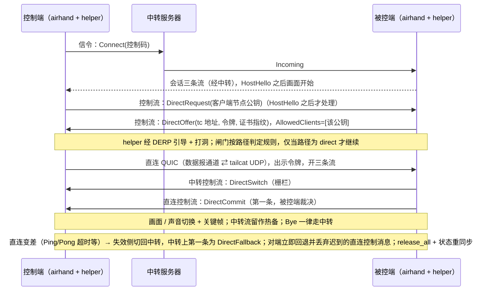

# tailcat 临时点对点直连：feature map

> 与 [`tailcat-p2p.md`](tailcat-p2p.md) 配套。基线：`sqlpxc/airhand` `main` @ `a317551`；tailcat 固定 `v0.7.0`（commit `15ab9e6`）。
> 状态：规格 r3.1（第 3 轮复审：无 S1，可提交批准 (A)），未实现。

## 能力 → 组件 → 阶段

| # | 能力 | 涉及组件 / 文件（现有或新增） | 阶段 | 验收（用例名见 spec） |
|---|---|---|---|---|
| F1 | 配置开关与默认关闭 | `client/src-tauri/src/config.rs`（`[direct]`） | 1 | `direct_config_*`、`disabled_by_default_never_spawns_helper` |
| F2 | 能力位协商 | `crates/airhand-proto/src/session.rs`（`HostHello` / `ControllerHello`） | 1 | `direct_messages_wire_is_stable`、`protocol_version_is_10`、`peer_without_direct_enabled_stays_on_relay` |
| F3 | 协议版本 9→10，握手编码不变 | `crates/airhand-proto/src/lib.rs`、`framing.rs` | 1 | `version_handshake_wire_is_stable` |
| F4 | `DirectRequest` / `DirectOffer`（`kind`+不透明 `body`）/ `DirectDecline` / `DirectCommit` / `DirectSwitch`（升级栅栏）/ `DirectFallback`（回退反向栅栏） 控制消息 | `crates/airhand-proto/src/session.rs` | 1 | 同上、`request_before_host_hello_is_dropped`、`unknown_offer_kind_is_declined`（I8 以 `DirectDecline` 协商，不依赖解码器容忍未知变体） |
| F5 | helper：tailcat 单 UDP 端口 ⇄ Rust 数据报通道（回环 UDP 或独立管道，Phase 0 二选一）；包过滤显式配置（TCP 空非 nil、单 UDP 端口）；`AllowedClients` 在 `Start` 前给定；按路径判定规则（非固定 250 ms）检测并在非 direct 时丢弃数据报（闸门）（客户端 `DiscoPing`、服务端 `Server.Status()`） | 新增 `p2p/`（Go 模块，依赖 tailcat `v0.7.0`） | 1 | `TestServesExactlyOneUDPPort`、`TestNoTCPServiceAndNoRST`、`TestOnlyAllowedClientKeyConnects`、`TestEmptyOrInvalidAllowlistRefusesToStart`、`TestGateDropsWhenPathNotDirect` |
| F6 | helper 控制协议（stdin/stdout JSON 行，地址不进 argv） | `p2p/`、`crates/airhand-link`（新增 `direct/` 模块：子进程监督、IPC） | 1 | `TestControlProtocolNeverEchoesAddressToArgvOrStderr`、`direct_secrets_are_redacted_in_debug_and_logs`（`Secret<T>`）、`helper_hash_mismatch_disables_direct` |
| F7 | 被控端直连 QUIC 监听（视候选：仅回环 UDP 或无本机端口）+ 一次性令牌 + 临时证书 | `crates/airhand-link/src/host.rs`、`transport.rs`、`net.rs`（复用证书固定） | 1 | `direct_token_*`、`direct_cert_pin_mismatch_aborts_upgrade`、`direct_listener_binds_loopback_only` / `direct_path_opens_no_local_port`（视候选） |
| F8 | 直连路径 QUIC 参数（载荷 ≤ 1232，关 PMTU 上调） | `crates/airhand-link/src/net.rs`（新 `direct_transport_config()`） | 1 | `direct_quic_never_sends_datagram_over_1232` |
| F9 | 升级状态机：被控端裁决提交（`DirectCommit`）、升级栅栏与回退反向栅栏、热备、关键帧、去重、回退后 `release_all()` 与状态重同步 | `crates/airhand-link/src/host.rs`、`controller/session.rs`、`transport.rs` | 1 | `session_upgrades_to_direct_*`、`host_fence_then_commit_is_first_direct_message`、`input_order_preserved_across_switch`、`fence_timeout_drops_buffer_and_releases_keys`、`late_direct_input_after_fallback_is_discarded`、`keys_released_after_fallback`、`settings_resynced_after_fallback`、`duplicate_frames_*`、`stale_lane_frames_*` |
| F10 | 健康检测与回退（不经共享 DERP 承载媒体） | 同上 + helper 路径事件 | 1 | `direct_failure_falls_back_to_relay`、`static_screen_does_not_trigger_fallback`、`missing_pong_triggers_fallback`、`commit_lost_controller_falls_back_within_bound`、`asymmetric_direct_failure_recovers_within_bound`、`fallback_message_forces_peer_to_fall_back`、`helper_crash_does_not_end_session`、`relay_loss_ends_session_even_when_direct`、`upgrade_timeout_keeps_relay` |
| F11 | 托盘 / 断开 / 更换控制码语义不变（桌面被控端没有“同意”环节；Android 的同意属 1.5） | `client/src-tauri/src/tray.rs`、`host/session.rs` | 1 | `no_offer_before_host_hello`、`kick_all_ends_direct_and_relay_lanes`、`new_code_ends_direct_session`、`kick_during_upgrade_ends_both_paths`（后三项在 `client/src-tauri`） |
| F12 | 打包：helper 随桌面安装包分发（固定同目录、哈希校验）；第三方许可声明；子项：Windows 防火墙行为、macOS 嵌套 helper 签名 / 公证 / hardened runtime / 应用防火墙弹窗、杀毒误报、卸载流程清理（`uninstall.rs`）、Linux 各分发形态 | `client/src-tauri/tauri.conf.json`、`client/src-tauri/src/uninstall.rs`、`docs/building.md`、`THIRD_PARTY_NOTICES` | 1 | 构建检查 + 许可审计清单 + 各子项手动验收记录 |
| F13 | 文档：用法 / 隐私 / 安全 / 限制 | `docs/usage.md`、`docs/security.md`、`docs/limitations.md`（及 zh-CN） | 1 | 评审检查 |
| F18 | Windows SYSTEM 被控端的 helper 降权：受限令牌 + 低完整性 + Job 对象 | `client/src-tauri/src/winsvc/` | 1（Phase 0 先证实可行） | `helper_token_is_restricted_on_windows` |
| F19 | 并发与资源：每会话一个 helper 实例、并发上限 | `crates/airhand-link/src/host.rs` | 1 | `two_concurrent_sessions_upgrade_independently`、`session_over_cap_stays_on_relay` |
| F20 | 发布与回滚：服务器镜像与全部客户端同步升级 v10 | 发布说明、`docker-compose.yml` 镜像重建 | 1 | 手动检查清单 |
| F14 | 网页控制台（容器内 helper） | `web/`、`web/Dockerfile` | 1.5 **TODO** | — |
| F15 | Android（无法拉子进程；候选：`main` 上的 `libtailcat` C ABI，需另行评审） | `android/` | 1.5 **TODO** | — |
| F16 | Tailscale：以本机 tailnet 地址为候选的直连（无需 tailcat） | `DirectOffer::Udp`、本机网卡枚举、非回环监听的独立安全评审 | 2 **TODO** | — |
| F17 | ZeroTier：以虚拟网卡地址为候选的直连 | 同上 | 3 **TODO** | — |

## 不变（不得改动）

- `server/`（中转服务器）**源码**：全部直连协商经会话控制流透传（但镜像须用 v10 重新构建）。
- 媒体包头（24 字节）、`crates/airhand-link/tests/protocol.json` 样例、Kotlin / TypeScript 解析器的行为（`android/native`、`web/` 的 Rust 代码需为新字段通过编译）。
- `ClientMsg::Hello` / `ServerMsg::Welcome` / `Incompatible` 与 ALPN 的编码。

## 数据流（Phase 1）

## 外部依赖与许可

| 依赖 | 版本 | 许可 | 用法 |
|---|---|---|---|
| `github.com/tailscale/tailcat` | **`v0.7.0`（commit `15ab9e6`）**，记录 `go.sum` 哈希；不依赖 `main` 上未发布 API | BSD-3-Clause | 仅库用法（`Server` / `Client` / UDP 端口），不用 CLI |
| 其传递依赖（`tailscale.com`、`wireguard-go`、gVisor …） | 随 tailcat `go.mod` | BSD-3 / MIT / Apache-2.0 等 | 实现阶段做完整许可审计 |
| 上游 `sqlpxc/airhand` | `a317551` | MIT | fork 后允许修改与再分发；须保留版权与许可声明 |
