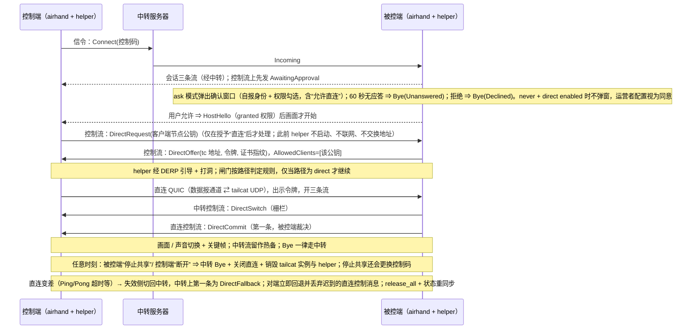

# tailcat 临时点对点直连：feature map

> 与 [`tailcat-p2p.md`](tailcat-p2p.md) 配套。基线：`sqlpxc/airhand` `main` @ `a317551`；tailcat 固定 `v0.7.0`（commit `15ab9e6`）。
> 状态：规格 r5（2026-11-10 项目负责人对开放问题 11–14 的决定：never 模式允许直连，显式配置视为同意；码率上限策略已定，C 待 Phase 0），未实现。

## 能力 → 组件 → 阶段

| # | 能力 | 涉及组件 / 文件（现有或新增） | 阶段 | 验收（用例名见 spec） |
|---|---|---|---|---|
| F1 | 配置开关与默认关闭 | `client/src-tauri/src/config.rs`（`[direct]`） | 1 | `direct_config_*`、`disabled_by_default_never_spawns_helper` |
| F2 | 能力位协商 | `crates/airhand-proto/src/session.rs`（`HostHello` / `ControllerHello`） | 1 | `direct_messages_wire_is_stable`、`protocol_version_is_10`、`peer_without_direct_enabled_stays_on_relay` |
| F3 | 协议版本 9→10，握手编码不变 | `crates/airhand-proto/src/lib.rs`、`framing.rs` | 1 | `version_handshake_wire_is_stable` |
| F4 | `DirectRequest` / `DirectOffer`（`kind`+不透明 `body`）/ `DirectDecline` / `DirectCommit` / `DirectSwitch`（升级栅栏）/ `DirectFallback`（回退反向栅栏） 控制消息 | `crates/airhand-proto/src/session.rs` | 1 | 同上、`request_before_host_hello_is_dropped`、`unknown_offer_kind_is_declined`（I8 以 `DirectDecline` 协商，不依赖解码器容忍未知变体） |
| F5 | helper：tailcat 单 UDP 端口 ⇄ Rust 数据报通道（回环 UDP 或独立管道，Phase 0 二选一）；包过滤显式配置（TCP 空非 nil、单 UDP 端口）；`AllowedClients` 在 `Start` 前给定；按路径判定规则（非固定 250 ms）检测并在非 direct 时丢弃数据报（闸门）（客户端 `DiscoPing`、服务端 `Server.Status()`） | 新增 `p2p/`（Go 模块，依赖 tailcat `v0.7.0`） | 1 | `TestServesExactlyOneUDPPort`、`TestNoTCPServiceAndNoRST`、`TestOnlyAllowedClientKeyConnects`、`TestEmptyOrInvalidAllowlistRefusesToStart`、`TestGateDropsWhenPathNotDirect` |
| F6 | helper 控制协议（stdin/stdout JSON 行，地址不进 argv） | `p2p/`、`crates/airhand-link`（新增 `direct/` 模块：子进程监督、IPC） | 1 | `TestControlProtocolNeverEchoesAddressToArgvOrStderr`、`direct_secrets_are_redacted_in_debug_and_logs`（`Secret<T>`）、`helper_hash_mismatch_disables_direct` |
| F7 | 被控端直连 QUIC 监听（视候选：仅回环 UDP 或无本机端口）+ 一次性令牌 + 临时证书 | `crates/airhand-link/src/host.rs`、`transport.rs`、`net.rs`（复用证书固定） | 1 | `direct_token_*`、`direct_cert_pin_mismatch_aborts_upgrade`、`direct_listener_binds_loopback_only` / `direct_path_opens_no_local_port`（视候选） |
| F8 | 直连路径 QUIC 参数（载荷 ≤ 1232，关 PMTU 上调） | `crates/airhand-link/src/net.rs`（新 `direct_transport_config()`） | 1 | `direct_quic_never_sends_datagram_over_1232` |
| F9 | 升级状态机：被控端裁决提交（`DirectCommit`）、升级栅栏与回退反向栅栏、热备、关键帧、去重、回退后 `release_all()` 与状态重同步 | `crates/airhand-link/src/host.rs`、`controller/session.rs`、`transport.rs` | 1 | `session_upgrades_to_direct_*`、`host_fence_then_commit_is_first_direct_message`、`input_order_preserved_across_switch`、`fence_timeout_drops_buffer_and_releases_keys`、`late_direct_input_after_fallback_is_discarded`、`keys_released_after_fallback`、`settings_resynced_after_fallback`、`controller_resends_cached_settings_audio_display_after_fallback`、`duplicate_frames_*`、`stale_lane_frames_*` |
| F10 | 健康检测与回退（不经共享 DERP 承载媒体）；直连会话码率达上限 C 时限制码率、不回退（C 由 Phase 0 的 R 写入 r6） | 同上 + helper 路径事件 + 现有 ABR | 1 | `direct_failure_falls_back_to_relay`、`static_screen_does_not_trigger_fallback`、`missing_pong_triggers_fallback`、`commit_lost_controller_falls_back_within_bound`、`asymmetric_direct_failure_recovers_within_bound`、`fallback_message_forces_peer_to_fall_back`、`helper_crash_does_not_end_session`、`relay_loss_ends_session_even_when_direct`、`upgrade_timeout_keeps_relay`、`direct_session_caps_bitrate_instead_of_falling_back`、`fallback_to_relay_lifts_direct_bitrate_cap` |
| F11 | 托盘 / 断开 / 更换控制码对直连会话语义与中转相同 | `client/src-tauri/src/tray.rs`、`host/session.rs` | 1 | `no_offer_before_host_hello`、`kick_all_ends_direct_and_relay_lanes`、`new_code_ends_direct_session`、`kick_during_upgrade_ends_both_paths`、`bye_always_sent_on_relay`（`client/src-tauri`） |
| F12 | 打包：helper 随桌面安装包分发（固定同目录、哈希校验）；第三方许可声明；子项：Windows 防火墙行为、macOS 嵌套 helper 签名 / 公证 / hardened runtime / 应用防火墙弹窗、杀毒误报、卸载流程清理（`uninstall.rs`）、Linux 各分发形态 | `client/src-tauri/tauri.conf.json`、`client/src-tauri/src/uninstall.rs`、`docs/building.md`、`THIRD_PARTY_NOTICES` | 1 | 构建检查 + 许可审计清单 + 各子项手动验收记录 |
| F13 | 文档：用法 / 隐私 / 安全 / 限制 | `docs/usage.md`、`docs/security.md`、`docs/limitations.md`（及 zh-CN） | 1 | 评审检查 |
| F18 | Windows SYSTEM 被控端的 helper 降权：受限令牌 + 低完整性 + Job 对象 | `client/src-tauri/src/winsvc/` | 1（Phase 0 先证实可行） | `helper_token_is_restricted_on_windows` |
| F19 | 并发与资源：每会话一个 helper 实例、并发上限 | `crates/airhand-link/src/host.rs` | 1 | `two_concurrent_sessions_upgrade_independently`、`session_over_cap_stays_on_relay` |
| F20 | 发布与回滚：服务器镜像与全部客户端同步升级 v10 | 发布说明、`docker-compose.yml` 镜像重建 | 1 | 手动检查清单 |
| F21 | **被控端确认**：桌面被控端默认 `approve = "ask"`（每个新会话，含纯中转），沿用现有 `AwaitingApproval` / `Declined` / `Unanswered` 机制（Android 已有）扩展到桌面；确认窗口显示自报身份 + 权限勾选（输入 / 剪贴板 / 声音 / 允许直连）；超时（60 秒）默认拒绝；授权前不发 `Hello` / 画面 / 地址。`approve = "never"` 须显式开启：不弹窗，按 I21 立即 `Hello`；与 `[direct] enabled` 同时开启时视为对直连 / 地址暴露的同意 | `crates/airhand-proto/src/session.rs`（`HostHello.granted`、`ByeReason::Busy`）、`client/src-tauri/src/host/session.rs` + 新确认窗口（Tauri）、`client/src-tauri/src/config.rs`（`[host] approve` 等）、更新 `e2e.rs`；确认闸门状态机下沉到 `airhand-link`（桌面与 Android 共用）；Windows：托盘确认窗 + `ToAgent::Approve/Decline`；前端 `client/` TypeScript 的确认窗与指示条 | 1 | `ask_mode_sends_awaiting_approval_and_no_hello`、`approval_timeout_sends_bye_unanswered`、`decline_sends_bye_declined`、`no_frames_or_audio_before_approval`、`non_hello_ping_bye_messages_cached_or_dropped_while_awaiting`、`approve_never_skips_prompt_and_sends_hello`、`prompt_waits_for_controller_hello_then_hides_direct_if_missing` |
| F22 | **直连同意先于地址交换**：未取得直连同意时，不处理 `DirectRequest`、不启动 helper、不联系 tailcat / DERP、不交换地址。同意来自确认窗勾选（ask），或运营者显式同时开启 `approve = "never"` 与 `[direct] enabled`（I21） | `crates/airhand-link/src/host.rs`、`controller/session.rs` | 1 | `no_offer_before_approval`、`direct_request_without_direct_grant_is_declined`、`helper_not_spawned_before_approval`、`declined_session_never_spawns_helper`、`ask_mode_no_offer_without_direct_checkbox`、`controller_never_requests_without_direct_grant`、`controller_helper_no_network_before_offer`、`approve_never_allows_direct_when_enabled`、`approve_never_direct_false_when_direct_disabled`、`approve_never_operator_config_counts_as_consent`、`config_change_to_never_during_input_session_not_applied` |
| F23 | **停止共享 / 主动断开（被控端）**：常驻指示（设备名、路径、权限）+ 一键“停止共享”（两条路径都关、销毁 tailcat 实例与 helper、更换控制码，`Bye(CodeChanged)`）+ “断开此控制端（保留控制码，`Bye(Kicked)`）”；周期性“是否继续共享”默认关（`reconfirm_minutes = 0`；开启时默认按钮为停止） | `client/src-tauri/src/tray.rs`、新增置顶指示条、`crates/airhand-link/src/host.rs`（`HostCmd` 清理直连资源；新增 `HostCmd::Kick { session_id }`） | 1 | `kick_session_command_ends_only_that_session`、`stop_sharing_sends_code_changed`、`stop_sharing_ends_relay_and_direct_paths`、`stop_sharing_rotates_code_old_code_rejected`、`disconnect_one_controller_keeps_code_and_closes_both_paths`、`late_direct_connection_after_stop_is_refused`、`session_indicator_shows_path_and_permissions`、`reconfirm_defaults_off`、`never_mode_kicked_device_can_return_until_code_changed` |
| F24 | **控制端主动断开**：`ControllerMsg::Bye`（经中转）+ 关闭直连 + 结束 helper；沿用 `Command::Disconnect` | `crates/airhand-link/src/controller/*`、`crates/airhand-proto/src/session.rs` | 1 | `controller_bye_closes_direct_and_kills_helper`、`controller_bye_sent_on_relay`、`controller_disconnect_during_upgrade_cleans_up` |
| F25 | 权限强制与回收：关输入丢弃输入；关剪贴板停两个方向；关声音取消订阅；收回“直连”即回退并销毁 helper，且本会话不再重试；`PermissionsChanged` 通知 | `crates/airhand-link/src/host.rs`、`client/src-tauri` | 1 | `revoking_input_permission_drops_input`、`revoking_clipboard_stops_both_directions`、`revoking_audio_unsubscribes`、`revoking_direct_permission_falls_back_and_destroys_helper`、`revoked_direct_not_retried_in_session`、`permissions_changed_notifies_controller`、`disabling_direct_falls_back_inflight_sessions` |
| F26 | 确认阶段的滥用防护（弹窗骚扰、未授权资源、自报文字清理）与校验串（SAS：只显示、不强制比对） | `client/src-tauri`、`crates/airhand-link` | 1 | `approval_prompt_text_is_sanitized_and_length_limited`、`pending_approvals_over_cap_get_busy`、`repeated_declines_from_same_source_are_silently_rejected`、`verification_string_matches_on_both_ends`、`verification_string_changes_if_offer_is_substituted`、`verification_string_is_displayed_not_required` |
| F27 | 工作流检查脚本 / CI 移植（隐私扫描、署名 trailer、spec-requires-tests） | `.github/`、`tests/`（独立 PR） | Phase 1 之前（独立 PR） | 独立 PR 自带 |
| F14 | 网页控制台（容器内 helper） | `web/`、`web/Dockerfile` | 1.5 **TODO** | — |
| F15 | Android（无法拉子进程；候选：`main` 上的 `libtailcat` C ABI，需另行评审） | `android/` | 1.5 **TODO** | — |
| F16 | Tailscale：以本机 tailnet 地址为候选的直连（无需 tailcat） | `DirectOffer::Udp`、本机网卡枚举、非回环监听的独立安全评审 | 2 **TODO** | — |
| F17 | ZeroTier：以虚拟网卡地址为候选的直连 | 同上 | 3 **TODO** | — |

## 不变（不得改动）

- `server/`（中转服务器）**源码**：全部直连协商经会话控制流透传（但镜像须用 v10 重新构建）。
- 媒体包头（24 字节）、`crates/airhand-link/tests/protocol.json` 样例、Kotlin / TypeScript 解析器的行为（`android/native`、`web/` 的 Rust 代码需为新字段通过编译）。
- `ClientMsg::Hello` / `ServerMsg::Welcome` / `Incompatible` 与 ALPN 的编码。

## 数据流（Phase 1）

## 外部依赖与许可

| 依赖 | 版本 | 许可 | 用法 |
|---|---|---|---|
| `github.com/tailscale/tailcat` | **`v0.7.0`（commit `15ab9e6`）**，记录 `go.sum` 哈希；不依赖 `main` 上未发布 API | BSD-3-Clause | 仅库用法（`Server` / `Client` / UDP 端口），不用 CLI |
| 其传递依赖（`tailscale.com`、`wireguard-go`、gVisor …） | 随 tailcat `go.mod` | BSD-3 / MIT / Apache-2.0 等 | 实现阶段做完整许可审计 |
| 上游 `sqlpxc/airhand` | `a317551` | MIT | fork 后允许修改与再分发；须保留版权与许可声明 |
| RustDesk（**仅设计参考，不复制代码**） | — | **AGPL-3.0**（与 MIT fork 不兼容地复制） | 被控端确认 / 断开 / 授权前资源限制的行为参考 |
| Chrome Remote Desktop（仅行为参考） | — | 专有服务；Chromium `remoting/` 为 BSD-3-Clause | 一次性码、共享确认、常驻停止共享、周期性续期的行为参考 |
| AnyDesk（仅行为参考） | — | 专有 | 接受窗口与权限勾选的行为参考 |
| magic-wormhole（评估后未采纳 PAKE） | — | MIT | SPAKE2 一次性码、校验串（SAS）的思路参考 |
