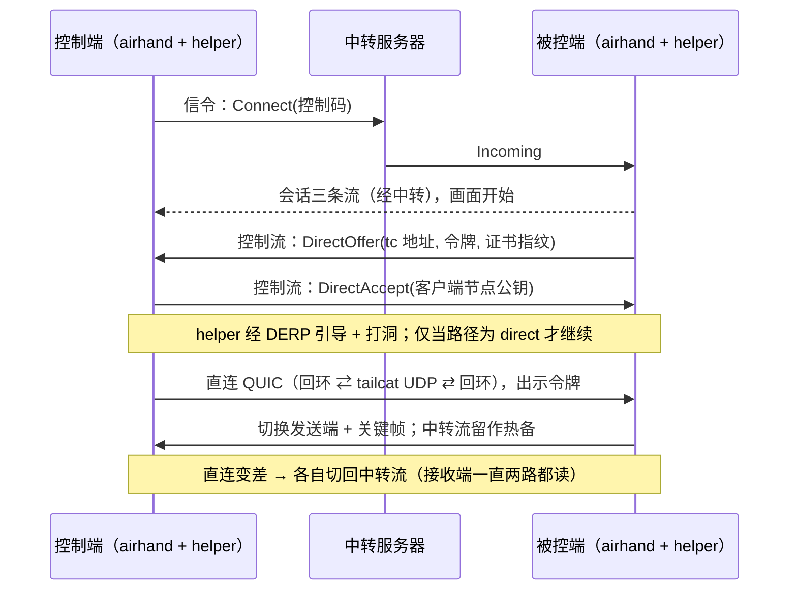

# tailcat 临时点对点直连：feature map

> 与 [`tailcat-p2p.md`](tailcat-p2p.md) 配套。基线：`sqlpxc/airhand` `main` @ `a317551`；tailcat `v0.7.0`。
> 状态：规格草案，未评审，未实现。

## 能力 → 组件 → 阶段

| # | 能力 | 涉及组件 / 文件（现有或新增） | 阶段 | 验收（用例名见 spec） |
|---|---|---|---|---|
| F1 | 配置开关与默认关闭 | `client/src-tauri/src/config.rs`（`[direct]`） | 1 | `direct_config_*`、`disabled_by_default_never_spawns_helper` |
| F2 | 能力位协商 | `crates/airhand-proto/src/session.rs`（`HostHello` / `ControllerHello`） | 1 | `direct_messages_wire_is_stable`、`peer_without_direct_capability_stays_on_relay` |
| F3 | 协议版本 9→10，握手编码不变 | `crates/airhand-proto/src/lib.rs`、`framing.rs` | 1 | `version_handshake_wire_is_stable` |
| F4 | `DirectOffer` / `Accept` / `Decline` / `Active` / `Fallback` 控制消息 | `crates/airhand-proto/src/session.rs` | 1 | 同上、`unknown_future_control_variant_*` |
| F5 | helper：tailcat 单 UDP 端口 ⇄ 回环 UDP 转发 | 新增 `p2p/`（Go 模块，依赖 tailcat 固定版本） | 1 | `TestServesExactlyOneUDPPort`、`TestNoTCPListeners`、`TestOnlyAllowedClientKeyConnects` |
| F6 | helper 控制协议（stdin/stdout JSON 行，地址不进 argv） | `p2p/`、`crates/airhand-link`（新增 `direct/` 模块：子进程监督、IPC） | 1 | `TestControlProtocolNeverEchoesAddressToArgvOrStderr`、`direct_secrets_are_redacted_in_debug_and_logs` |
| F7 | 被控端直连 QUIC 监听（仅回环）+ 一次性令牌 + 临时证书 | `crates/airhand-link/src/host.rs`、`transport.rs`、`net.rs`（复用证书固定） | 1 | `direct_token_*`、`direct_listener_binds_loopback_only`、`direct_cert_pin_mismatch_aborts_upgrade` |
| F8 | 直连路径 QUIC 参数（载荷 ≤ 1232，关 PMTU 上调） | `crates/airhand-link/src/net.rs`（新 `direct_transport_config()`） | 1 | `direct_quic_payload_capped_to_p2p_mtu` |
| F9 | 升级状态机：热备、纪元、关键帧、去重 | `crates/airhand-link/src/host.rs`、`controller/session.rs`、`transport.rs` | 1 | `session_upgrades_to_direct_*`、`duplicate_frames_*`、`stale_lane_frames_*` |
| F10 | 健康检测与回退（不经共享 DERP 承载媒体） | 同上 + helper 路径事件 | 1 | `direct_failure_falls_back_to_relay`、`derp_only_path_never_carries_media`、`upgrade_timeout_keeps_relay` |
| F11 | 同意 / 托盘 / 断开 / 更换控制码语义不变 | `client/src-tauri/src/tray.rs`、`host/session.rs` | 1 | `direct_session_requires_same_approval_*`、`kick_all_*`、`new_code_*` |
| F12 | 打包：helper 随桌面安装包分发；第三方许可声明 | `client/src-tauri/tauri.conf.json`、`docs/building.md`、`THIRD_PARTY_NOTICES` | 1 | 构建检查 + 许可审计清单 |
| F13 | 文档：用法 / 隐私 / 安全 / 限制 | `docs/usage.md`、`docs/security.md`、`docs/limitations.md`（及 zh-CN） | 1 | 评审检查 |
| F14 | 网页控制台（容器内 helper） | `web/`、`web/Dockerfile` | 1.5 **TODO** | — |
| F15 | Android（嵌入式 Go / gomobile，无法拉子进程） | `android/` | 1.5 **TODO** | — |
| F16 | Tailscale：以本机 tailnet 地址为候选的直连（无需 tailcat） | `DirectOffer::Udp`、本机网卡枚举、非回环监听的独立安全评审 | 2 **TODO** | — |
| F17 | ZeroTier：以虚拟网卡地址为候选的直连 | 同上 | 3 **TODO** | — |

## 不变（不得改动）

- `server/`（中转服务器）：全部直连协商经会话控制流透传。
- 媒体包头（24 字节）、`crates/airhand-link/tests/protocol.json` 样例、Kotlin / TypeScript 解析器。
- `ClientMsg::Hello` / `ServerMsg::Welcome` / `Incompatible` 与 ALPN 的编码。

## 数据流（Phase 1）

## 外部依赖与许可

| 依赖 | 版本 | 许可 | 用法 |
|---|---|---|---|
| `github.com/tailscale/tailcat` | `v0.7.0`（实现时固定到已核对的 tag/commit，并记录哈希） | BSD-3-Clause | 仅库用法（`Server` / `Client` / UDP 端口），不用 CLI |
| 其传递依赖（`tailscale.com`、`wireguard-go`、gVisor …） | 随 tailcat `go.mod` | BSD-3 / MIT / Apache-2.0 等 | 实现阶段做完整许可审计 |
| 上游 `sqlpxc/airhand` | `a317551` | MIT | fork 后允许修改与再分发；须保留版权与许可声明 |
